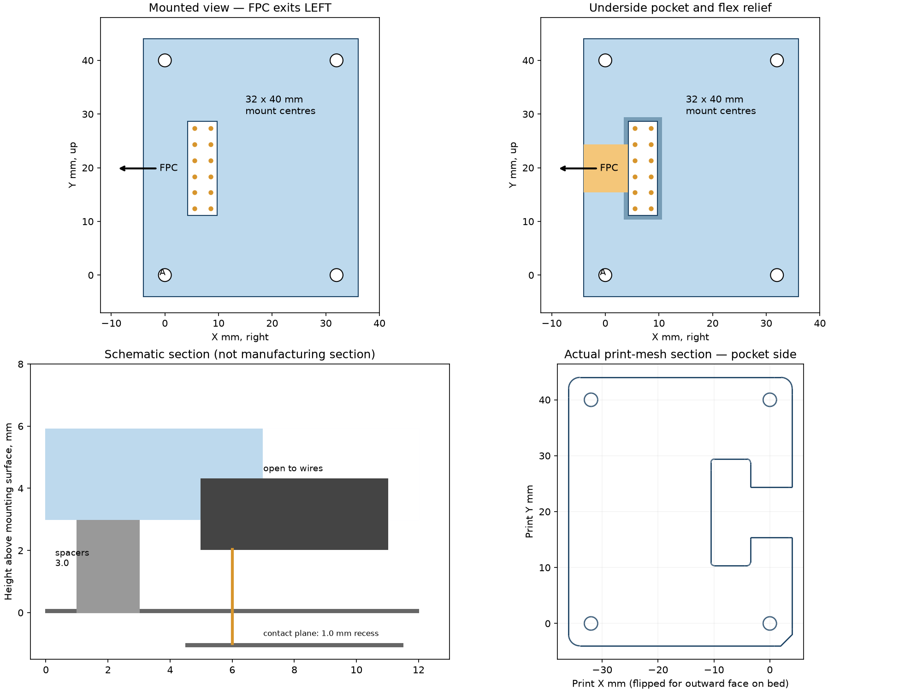

# T865 FPC connector retaining plate — R3

Printable retaining plate for the existing 2 × 6 pogo/FPC connector. It uses
the selected P1 contact location and 32 × 40 mm mounting pattern. Looking at
the tablet back with camera up and USB right, **the FPC exits LEFT**. The solder
side faces outward, exposed through a central window for wires and probing.



R3 sizes the plate for the supplied **8.5 mm screws** and **1.5 mm target thread
engagement**. The plate is now **4.00 mm thick**, with the same 3.00 mm nominal
spacer stack and 4.30 mm retaining plane. The 1 mm contact recess remains included.
Reprint the R3 plate; the R2 spacers can be reused.

## Files to print

- **T865-FPC-retainer-print.stl**: one plate already rotated with the flat outward
  face on the bed and underside pocket up. Keep that orientation.
- **T865-FPC-spacer-kit.stl**: four 2.60 mm spacers, four 0.40 mm shims and four
  0.20 mm shims. Each is a separate solid. Thin shims are optional when adjusting.
- Individual `spacer-*.stl` files are supplied for replacements.

All dimensions are millimetres. Print at 100%, initially with 0.2 mm layers and
three or more perimeters. The 0.2 mm shims are single-layer prints. No support
is intended in the supplied orientation. Check the slicer preview, especially
the narrow retaining rim. PETG is a reasonable fit-test material; physical fit
and material performance have not been tested. Deburr pocket, holes and flex
passage before inserting the connector.

The assembly-coordinate STL is a CAD reference, not the preferred bed orientation.
The reference-assembly STEP includes dummy connector, FPC and spacer stacks;
**do not print those dummy connector/FPC bodies**.

## Measured inputs and geometry

| Feature | Value | Basis |
| --- | --- | --- |
| Connector body envelope | 18.67 × 6.67 mm | Caliper photos IMG20261111204318 and IMG20261111204245 |
| Housing thickness | 2.27 mm | User measurement, 2026-11-13 |
| Free tip to solder top | **5.60 mm** | User correction; supersedes 5.25 mm |
| Fully compressed tip to solder top | 4.60 mm | User measurement |
| Measured travel | 1.00 mm | Difference of the corrected heights |
| Grid | 3 mm, 2 × 6 | Prior tablet measurements |
| Pin 11 | X 5.500, Y 12.367 mm | Selected P1 gauge, relative to lower-left mount A |
| Body centre | X 7.000, Y 19.867 mm | Assumes housing centred around contact grid |
| Mount pattern | 32 × 40 mm | Same working baseline as selected P1 gauge |
| Mount clearance holes | 2.40 mm | For M2 fasteners; no countersinks |
| Plate envelope | 40 × 48 × 4.00 mm | Matches prior gauge footprint |
| Underside pocket | 7.07 × 19.07 mm, 1.30 mm deep | 0.20 mm clearance per side |
| Through window | 5.47 × 17.47 mm | Leaves nominal 0.60 mm overlap on housing rim |
| Roof | 2.70 mm | Retaining thickness above pocket |
| Left flex relief | 9.0 mm wide, 1.70 mm deep | Design allowance; 0.40 mm above nominal rim plane |
| Contact plane recess | About 1.00 mm | User measurement, 2026-11-13 |
| Initial standoff | 3.00 mm | 2.60 mm spacer + 0.40 mm shim at each screw |
| Initial retaining plane | 4.30 mm above mounting surface | Standoff + pocket depth |

Measured body dimensions are separate from print clearances. Housing centring,
corner radii, flex width/thickness allowance and solder-pad diameter are inferred
from photos, not independently measured. The pocket has R0.6 corners and the
window R0.5 corners. The pads fit the nominal window if their radius is under
1.235 mm; inspect the actual solder joints before clamping. Do not rest the
retaining rim on a joint or wire.

## Height adjustment and assembly

The default 4.30 mm retaining plane targets **0.30 mm compression** only under
the reported approximately **1.00 mm contact recess**, and the assumption that
the measured solder-top plane coincides with the housing rim on which the
retainer bears. The recess measurement is approximate and the solder-to-rim
offset remains unverified; both affect actual preload. This is a fit prototype,
not a qualified connector compression stop.

1. With the connector removed, check the plate's mounting holes and clearance
   around the upper-left cap-retaining screw/strap. Corner A has a notch. Take
   account of the existing cap hardware at the opposite upper-left mount.
2. Feed the **FPC left** through the underside relief and the loose wires upward
   through the window. The connector inserts from the tablet-facing underside;
   the plate then overlaps the housing rim while the pogo tips face the tablet.
3. Start with equal, taller spacer stacks, for example 2.60 + 0.40 + 0.20 mm at
   all four screws. Check the connector can seat without flex/wire pinching.
4. Reduce equal stacks only after inspecting the actual contact and housing
   position. Tighten gently to the spacers. The plate should remain flat; do not
   use screw force to bend it down onto the connector or reach full pogo travel.
5. Verify retention and contact alignment. No pull test or electrical continuity
   is established by CAD. Route wires with slack so they do not lift the housing.

| Equal spacer stack at all screws | Retaining plane | Nominal compression, before datum correction |
| --- | --- | --- |
| 2.60 + 0.40 + 0.20 = 3.20 mm | 4.50 mm | 0.10 mm |
| 2.60 + 0.40 = 3.00 mm | 4.30 mm | 0.30 mm |
| 2.60 + 0.20 = 2.80 mm | 4.10 mm | 0.50 mm |
| 2.60 mm | 3.90 mm | 0.70 mm |

These are adjustment options, not validated operating loads. Actual working
travel must leave margin from the measured 4.60 mm fully compressed height.
If the plate touches the solder joints, increase the window or change the
retaining surface; do not push on them to achieve the listed height.

The supplied screws are specified as **M2×8.5**; the user confirms the nominal
**8.50 mm length excludes the head**. This is a supplied specification, not a
caliper measurement. With **4.00 mm plate + 3.00 mm
spacer stack = 7.00 mm** under the screw head, nominal thread engagement is
**1.50 mm**, leaving **0.50 mm** before the reported approximately 2 mm thread
depth. Screw length here is the length from the head's bearing face to its tip;
this plate uses flat bearing faces and no countersinks. Any cap strap or washer
under a head changes that screw's engagement and must be included in its stack.

| Spacer stack | Plate + spacers | Nominal engagement with 8.50 mm screw |
| --- | --- | --- |
| 3.20 mm | 7.20 mm | 1.30 mm |
| 3.00 mm | 7.00 mm | 1.50 mm |
| 2.80 mm | 6.80 mm | 1.70 mm |
| 2.60 mm | 6.60 mm | 1.90 mm |

The lower stacks leave less bottoming margin. Do not tighten against the end of
the threaded hole. Engagement and preload remain physical fit checks.

## Editable CAD and regeneration

`parameters.json` is the source of dimensions. `generate.py` is an editable
CadQuery feature sequence: rounded blank, underside pocket, wire window, left
relief, mounting holes, corner key and recessed labels. STEP files are neutral
solids; the generator preserves editability. Fusion was unavailable, so no F3D
archive or Fusion timeline is supplied.

- `T865-FPC-retainer-assembly-coordinates.step`: plate in tablet-back XY coordinates.
- `T865-FPC-retainer-print.step`: same solid in print orientation.
- `T865-FPC-reference-assembly.step`: named parts plus non-printable reference bodies.
- `T865-FPC-dimension-envelope.dxf`: dimension/sketch envelopes on separate layers;
  the envelope rectangles omit corner radii and labels. It is **not** a flat cut
  profile for the whole part: pocket, relief and window have different depths.

```sh
uv venv --python 3.12 .venv
uv pip install --python .venv/bin/python -r requirements.txt
.venv/bin/python generate.py
```

For height calibration, parameters use:

```text
retaining_height = free_tip_to_solder_top - target_compression
                   - contact_plane_recess - solder_top_above_retaining_rim
standoff_height = retaining_height - pocket_depth
plate_thickness = screw_length - target_thread_engagement - standoff_height
roof_thickness = plate_thickness - pocket_depth
```

`contact_plane_recess` is positive when tablet contacts lie below the mounting
surface. `solder_top_above_retaining_rim` is positive when solder projects above
the rim. The recess is set to 1.00 mm from the user measurement; the solder-to-rim
offset defaults to zero as an explicit unknown. Update the base spacer height
to preserve the intended 0.40 mm nominal shim stack when these parameters change;
the generator checks the stack rather than silently exporting the wrong height.
Plate thickness is derived from screw length and engagement; a minimum roof
thickness check rejects a combination that makes the retaining roof too thin.

## Validation and limits

`validation.json` records CAD validity, single connected plate, watertight and
consistently wound STL, positive volume, STEP round-trip volume, twelve separate
spacers/shims, a connector-envelope interference check and a modest parameter
change/recompute test. Preview inspected after generation. Checks concern the
model only; no sliced print, physical assembly, electrical contact or retention
force has been tested. Existing tablet bosses, recess walls and cap strap are
not fully modelled.

References: [selected P1 geometry](../fit-check/README.md),
[connector photos and measurements](../../docs/reports/EXPANSION-ADAPTER-2026-11-11.md),
and [current electrical/mechanical notes](../../docs/measurements.md).
