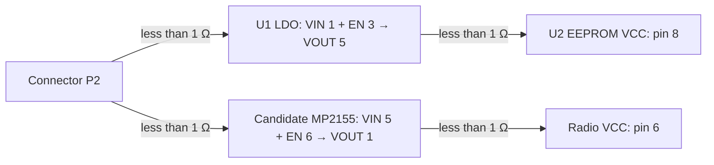

# Current measurement index - 2026-11-13

This is the entry point for the electrical and mechanical measurements. Earlier
reports preserve the sequence of observations and corrections; use the latest
confirmed statements here when interpreting those historical records.

## Pin numbering and UART

Looking at the tablet back with the camera toward the top and USB exiting right:

| Left | Right |
| --- | --- |
| 1 | 2 |
| 3 | 4 |
| 5 | 6 |
| 7 | 8 |
| 9 | 10 |
| 11 | 12 |

Pin 1 is the user's ground reference. Pin 11 is /dev/ttysWK2 RX and pin 12 is
/dev/ttysWK2 TX, physically verified with exact payloads in both directions
using ESP32 GPIO26 TX and GPIO25 RX, at 9600/8N1. No new /dev/expand enable
command was used in that bench test; cold-boot behaviour without preceding DMD
enable cycles is untested. The radio module was not fitted.

| Pin | User's sequential multimeter reading relative to pin 1 |
| --- | --- |
| 2 | Initially about 2.5 V, falling; final level not established |
| 3 | 0 mV at that instant; separately observed to pulse high during LoRa enable |
| 4 | 1.79 V |
| 5 | 1.5 V |
| 6 | 36 mV |
| 7 | 3.3 V |
| 8 | 1 mV; not established as ground |
| 9 | 3.3 V |
| 10 | 39 mV |
| 11 | 2.49 V; confirmed UART RX |
| 12 | About 2.5 V idle; confirmed UART TX |

Pin 12 also measured 2.464 V relative to a cradle ground pad. The measurements
were sequential, so that difference does not establish a fixed ground offset.
Low readings do not identify a ground pin, and measured high levels do not
establish input tolerance, output current capability or a usable supply.

See [pin map](reports/EXPANSION-PIN-MAP-2026-11-07.md),
[UART end-to-end test](reports/UART-END-TO-END-2026-11-07.md),
[probe wiring](reports/RX-PROBE-WIRING-2026-11-07.md),
[driver analysis](reports/EXPAND-DRIVER-ANALYSIS.md) and
[full handoff](reports/EXPANSION-PORT-HANDOFF.md).

The [GpioControl API trace](gpio-control-api.md) identifies logical I/O indices
used by the SDK/factory client. Position 2 / I/O 1 maps to kernel GPIO 566 in the
recorded log. Factory indices 2..5 are readback inputs in its test sequence;
their current-kernel validity, direction capabilities and contact mapping remain
unverified. Connector numbering, logical I/O indices and kernel GPIO numbers are
separate namespaces.

## Connector and mounting geometry

Contact openings are approximately 1.6 mm diameter. Measured outside spans
4.6 mm across two holes and 16.4 mm across six support a nominal **3 x 3 mm**
contact grid, with a 15 x 3 mm contact-centre rectangle.

Four mounting locations form a rectangle; the upper-left screw also retains
the cap of the round screw-in connector. The screw measured 1.94 mm outside
diameter, consistent with M2; the threaded opening measured about 1.75 mm.
Thread pitch and usable engagement depth were not measured.

The mounting spans **33.55 and 41.37 mm** were measured across the farthest
edges of the **threaded openings**, not the brass insert OD. Subtracting 1.75
gives 31.80 x 39.62 mm centres. The gauges test provisional nominal **32 x 40 mm**
spacing. It is not a verified OEM pattern; the long-axis difference is 0.38 mm.

The brass insert visible OD is **3.3 mm**, surrounded by a roughly 4 mm plastic
ring. The later 8.58 and 15.01 mm pin-11 spans referenced the brass OD and contact
opening, giving rough offsets 6.13 x 12.56 mm. These have substantially larger
error because there was no hard measurement stop.

A later shortest diagonal gap between the threaded-opening edge and pin-11
opening edge was **11.86 mm**, with further readings 11.75 and 12.00 mm and
approximately +/-0.1 mm error. This implies **13.535 mm centre distance** for
the working 11.86 value. It constrains a radius, not a unique contact angle.

The four [labelled fit gauges](../cad/fit-check/README.md) vary the pin-11
X offset from 5.5 to 7.0 mm and derive Y to preserve that diagonal. Original
[HEIC photos](../measurements/photos/originals/) and
[JPEG previews](../measurements/photos/previews/) document the measurements.

**Selected fit baseline: P1 R2**, based on the later physical comparison on
2026-11-07. User reports P1 alignment "just about perfect", P2 visibly misaligned,
and P3/P4 very badly aligned. The photographs show the same progression. Pin 11
is **(5.500, 12.367) mm** relative to lower-left mounting centre A; pin 12 is
**(8.500, 12.367) mm**, and pin 1 is **(5.500, 27.367) mm** in the model's rear-view
coordinate system. Keep the existing 32 x 40 mm mount pattern and 3 mm grid for
the selected prototype. The CAD values do not establish sub-millimetre accuracy:
2.4 mm inspection windows, seating and photograph perspective limit that claim.
Recess depth, working compression and an electrical pogo-pin contact fit remain
unmeasured. The other offsets are retained as rejected test variants.

See [reference index](../references/README.md) for individual pogo-pin candidates
and the earlier connector sourcing leads. No off-the-shelf 2x6/3 mm EU-stock
connector or final mechanical fit was established in that search.

## Evidence organization

First fit-check photos (IMG20261107175954 and IMG20261107180655): the user reports
slight top mounting-hole misalignment for P1 and good top-hole alignment for P2.
Their CAD mounting-hole coordinates are identical; printing, placement and seating
differences have not been isolated. The original contact inspection holes were too
small to judge alignment reliably. R2 enlarges those holes from 1.6 to 2.4 mm and
adds a raised revision label, while retaining all centres and offset variants.
This was the earlier first-print observation. The subsequent R2 comparison selects
P1: IMG20261107221537 (P1), IMG20261107221707 (P2), IMG20261107221817 (P3) and
IMG20261107221926 (P4). See the CAD README for the comparison table.

Original versioned captures are under
[the port-probe analysis directory](../android/T865PortProbe/analysis/).
[measurements/scope-workspace](../measurements/scope-workspace/) preserves the
additional capture workspace with its original relative paths. Some files are
duplicates of the versioned bundles; this preserves bundle/script references.

[evidence-manifest.json](evidence-manifest.json) records source groups, repository
paths, byte sizes and SHA-256 hashes for supplementary imported evidence. It does
not enumerate the application files already preserved in their Git histories.

## LoRa module teardown (2026-11-11)

[Disassembly analysis](reports/LORA-MODULE-TEARDOWN-2026-11-11.md) identifies
the shielded module as **EBYTE E220-900T30S** and U2 as an **AT24C02C** EEPROM.
The `ADRS / 883` power-stage IC is a high-confidence **MP2155GQ buck-boost**
match (manufacturer top mark `ADR`, ten-pad package, adjacent `3R3` inductor).
Its output voltage and enable wiring remain unmeasured. The EEPROM's `0x56`
board label likely denotes its I2C address; no contents were read.
[Original photos and previews](../measurements/photos/lora-teardown-2026-11-11/)
preserve the evidence. These photos do not yet establish a carrier schematic
or prove the absence of an MCU.

Follow-up close-ups identify U1 as a strong **LP3987H-33B5F (3.3 V LDO)**
match using the manufacturer's `LPS / 1eYWX` marking table. The paired `KN`
transistors are candidate **2SK3018-family MOSFETs**; exact manufacturer and
signal connections remain unverified. U1 has five pins, correcting the
initial impression from the wider photo.

## Contact relocation adapter (2026-11-11)

[Adapter photos and assessment](reports/EXPANSION-ADAPTER-2026-11-11.md) show
a passive-looking flex between two 2 x 6 contact arrays, with pogo contacts
at one end and flat lands at the other. User reports four mounting screws
at one end and two at the other. Flex text includes `MDT65-barometer-FPC`
and `JFHD-MDT865`; the presumed phone association is unconfirmed.
No contact mapping or mechanical dimensions have been derived from the photos.

Caliper photos now record the FPC pogo block's black body as **18.67 x 6.67 mm**
(length x width). Body height, pin protrusion/travel, corner radii and flex-exit
clearance remain unmeasured; printer fit allowance is separate from these dimensions.

The [unpowered radio PCB probing plan](reports/RADIO-PCB-PROBE-PLAN-2026-11-11.md)
prioritizes ground, supply paths, enables/mode pins, UART and EEPROM mapping
before the connector side becomes inaccessible. Pin 2 as switched supply
is a working hypothesis from the wider FPC trace and earlier voltage decay,
not a confirmed electrical assignment.

## Radio PCB resistance measurements (2026-11-13)

| From | To | Reported resistance |
| --- | --- | --- |
| P1 | U2 EEPROM pin 4 (GND) | 0.8 Ω |
| P1 | U.FL shield | 0.8 Ω |
| P1 | U1 pin 2 (GND) | <1 Ω |

These user readings support P1 sharing ground with U1, the EEPROM and the
antenna connector shield. Shorted-lead/contact resistance and reverse-probe
readings were not supplied; the values include lead/contact resistance.
The [probing worksheet](reports/RADIO-PCB-PROBE-PLAN-2026-11-11.md)
records all three readings and the photo-based U1 pin orientation.

### Connector-to-ground survey

User readings on the radio PCB in the ongoing unpowered session. The user
confirms **U2 pin 4 (GND)** was the accessible reference for the survey; pogo
contacts are probed one at a time because they are difficult to contact reliably.

| Contact | Resistance to U2 pin 4 (GND) |
| --- | --- |
| P2 | ≈500 Ω |
| P3 | Open |
| P4 | Open |
| P5 | <1 Ω in both probe directions |
| P6 | Open |
| P7 | ≈640 Ω |
| P8 | Open |
| P9 | ≈722 Ω |
| P10 | Open |
| P11 | ≈833 Ω |
| P12 | ≈833 Ω |

“Others open” supplies the P3/P4/P6/P10 entries. Reverse-probe readings for
contacts other than P5, settling behaviour and lead baseline remain unreported.
Open means the reported meter indication; finite readings include all in-circuit paths.

**P5 shares the radio PCB ground with strong continuity evidence:** below 1 Ω
to U2 pin 4 in both directions. Earlier unloaded tablet-side P5 measured 1.5 V
relative to P1. The user's proposed weak tablet-side pull-up could explain that
reading, but no loaded-voltage test or circuit trace has established it. The
board-ground measurement does not establish the tablet-side pin circuitry.
P11/P12 having equal readings does not establish continuity between them.

### P2 power-path trace

| From | To | Reported resistance |
| --- | --- | --- |
| P2 | U1 pin 1 (VIN) | <1 Ω |
| P2 | Candidate MP2155 pin 5 (VIN) | <1 Ω |
| P2 | Candidate MP2155 pin 6 (EN) | <1 Ω |
| P2 | U1 pin 3 (EN) | <1 Ω |
| P2 | U1 pin 5 (VOUT) | ≈570 Ω |
| P2 | U2 pin 8 (VCC) | Open |
| P2 | Radio pin 6 (VCC) | Open |

**P2 has a low-resistance connection to U1 VIN.** Applied voltage, upstream
switching and downstream supply routing remain unverified. Open readings from
P2 to load VCC pads do not rule out a power path through an enabled regulator.
The 570 Ω reading is an in-circuit value, not a proven discrete resistor.
Reverse-probe and settling results were not supplied.

The [exact module manual supplied by the user](../references/lora-teardown/E220-900T30S_UserManual_EN_v1.0.pdf)
resolves the radio pin numbering: this is the **18-pad layout**, with **pin 6
VCC**, pin 7 GND, pin 3 RXD, pin 4 TXD, pin 1 M0, pin 2 M1 and pin 5 AUX.
The older archived manual describes a different **24-pad layout** and must not
be used for this module's pin numbering. The worksheet now uses the correct manual.

### U1 output trace

| From | To | Reported resistance |
| --- | --- | --- |
| U1 pin 5 (VOUT) | U2 pin 8 (VCC) | <1 Ω |
| U1 pin 5 (VOUT) | Radio pin 6 (VCC) | ≈650 Ω |
| Candidate MP2155 pin 1 (VOUT) | Radio pin 6 (VCC) | <1 Ω |

The low-resistance connection establishes that U2 EEPROM VCC shares U1's output
net. U1's marking identifies the nominal 3.3 V LDO variant; no powered output
voltage has been measured. The 650 Ω in-circuit reading does not establish a
shared rail with radio VCC or a discrete 650 Ω resistor. Radio supply routing was subsequently traced to candidate MP2155 VOUT (below). Reverse-probe readings and settling behaviour were not reported.

### U1 input/output probe-polarity check (2026-11-13)

| Red probe | Black probe | Reported resistance |
| --- | --- | --- |
| U1 pin 5 (VOUT) | P2 (connected to U1 VIN) | ≈570 Ω |
| P2 (connected to U1 VIN) | U1 pin 5 (VOUT) | Open or ≈1.2 kΩ on separate probe placements; stable while held |

The user now reports polarity-dependent readings between the LDO input and
output nets. This is consistent with semiconductor paths in the unpowered
circuit; it does not identify a fixed 570 Ω resistor or a particular internal
diode. The user clarifies that the reverse result changes only on re-probing:
each placement reads either open or approximately 1.2 kΩ, and the reading holds
while the probes remain in place. This is not a fluctuating reading under held
contact. The reason for the difference between placements has not been isolated;
the observation does not establish charging or meter-range changes.

Polarity dependence provides a plausible explanation for the earlier 570 Ω
P2-to-U1 pin 5 reading versus the open P2-to-U2 pin 8 reading, despite the
below-1 Ω connection between U1 pin 5 and U2 pin 8. The earlier probe polarity
was not recorded, and a matched-polarity repeat using U2 pin 8 has not been
reported, so retain both original observations. The direct low-resistance
connections still establish P2-to-U1 VIN and U1 VOUT-to-EEPROM VCC.

Subsequent regulator-enable results are recorded below.

### Shared regulator input and traced outputs

User reports MP2155 pin 5 to P2 **<1 Ω**, and MP2155 pin 1 to radio pin 6
**<1 Ω**. Assuming the candidate MP2155 identification, P2 feeds both regulator
inputs, U1 VOUT connects to EEPROM VCC, and MP2155 VOUT connects to radio VCC.

The external links represent measured low-resistance connections; the regulator
blocks identify their input/output functions, not continuity through each IC.
Both EN pins also trace to P2, as detailed below. Actual powered voltages and
any upstream P2 switching remain unmeasured.

### Enable wiring and P3 polarity check (2026-11-13)

| Connection / probe polarity | Reported result |
| --- | --- |
| Candidate MP2155 pin 6 (EN) to P2 | <1 Ω |
| P2 to U1 pin 3 (EN) | <1 Ω |
| P3 to regulator EN pins and radio M0/M1 | No direct connection reported; individual resistance values not supplied |
| Red on P1, black on P3 | ≈1 kΩ |
| Red on P3, black on P1 | Open |
| Diode mode: red P1, black P3 (assumed from “P#”) | 0.97 V |
| Diode mode: red P3 (same assumption), black P1 | Open / OL |

Both regulator EN pins join P2 alongside their VIN pins. This supports the
interpretation that both stages enable when P2 is powered, rather than receiving
separate direct enable signals from P3. Powered sequencing, input voltage and
upstream switching of P2 remain unmeasured. No direct P3-to-EN or P3-to-M0/M1
connection was found; this does not exclude indirect control through other parts.

The P3 reading is polarity-dependent and supports a semiconductor-path hypothesis.
The user suggests a MOSFET body diode. That is possible, but a ground-to-signal
ESD clamp can give the same conduction polarity; the resistance reading alone
identifies neither a MOSFET nor a fixed 1 kΩ resistor. General references:
[Toshiba on MOSFET body diodes](https://toshiba.semicon-storage.com/eu/semiconductor/knowledge/faq/mosfet/i-heard-that-mosfets-have-a-diode-between-drain-and-sourcewhat-k.html)
and [TI on ground clamp diodes](https://www.ti.com/document-viewer/lit/html/SSZTCN0/GUID-540DB5B6-45A1-40EF-A3C7-A07EB772C47F).
These explain candidate mechanisms, not identification of parts on this board.

The subsequent diode-mode report is 0.97 V with red on P1 and black on the
contact written as “P#”, and open in reverse. “P#” is interpreted as P3 from
the immediately preceding test; that interpretation has not been separately
confirmed. The result supports a diode-like path but does not identify a
particular junction or establish a MOSFET body diode.

Next unpowered check: trace P3 to terminals of the paired KN devices and nearby
protection parts without assuming their pinouts. Record any low-resistance
connection and which physical terminal it reaches.

### Q1/Q2 adjacent-resistor traces (2026-11-13)

Orientation for these observations: **pogo pins are up**. The user calls the
two devices Q1 and Q2; “lower-right” is a physical terminal position in this
orientation, not an assigned semiconductor pin number.

| From | To | Reported resistance |
| --- | --- | --- |
| Q1 lower-right terminal | Near end of its adjacent resistor | <1 Ω |
| Other end of Q1-adjacent resistor | P1 (GND) | <1 Ω |
| Q2 lower-right terminal | Near end of its adjacent resistor | <1 Ω |
| Other end of Q2-adjacent resistor | P1 (GND) | <1 Ω |

Each lower-right terminal has a path through its adjacent resistor to ground.
The two below-1 Ω trace segments are not a below-1 Ω terminal-to-ground reading.
The user's follow-up gives the resistor measurements below, using the same
pogo-pins-up orientation. Both left-side resistors connect to their respective
device's lone left terminal; the far ends of those resistors remain untraced.
No numerical continuity reading was supplied for these left-side connections.

| Resistor position | Reported in-circuit resistance |
| --- | --- |
| Right side, upper | ≈46 kΩ |
| Right side, lower | ≈46 kΩ |
| Left side, lower | ≈7.4 kΩ |
| Left side, upper | ≈4 kΩ |

The right-side values are recorded as approximately 46 kΩ each from the plural
report. Upper/lower have not been assigned to Q1/Q2 reference designators.
Printed markings and isolated component values were not supplied; parallel
board circuitry can affect these in-circuit readings. Gate/source/drain
assignments, exact device models and any P3 connection remain unestablished.

Follow-up on the opposite ends of the left-side resistors (the ends away from
the lone transistor terminals):

| From | To | Resistance mode | Continuity mode |
| --- | --- | --- | --- |
| Upper left resistor, opposite end | P3 | ≈2.2 MΩ | Open |
| Lower left resistor, opposite end | P3 | ≈2.2 MΩ | Open |

Both entries follow the user's plural report; probe polarity was not supplied.
The finite high-resistance reading and the open continuity indication are
consistent and show no direct continuity at these points. Do not record this
as a discrete 2.2 MΩ resistor or infer that all indirect P3 paths are excluded.
The destinations of these resistor ends remain unknown.

Next unpowered check: P3 to the upper-right terminal of each Q1/Q2, keeping
pogo pins up. These terminals remain unmapped; record physical position rather
than assigning gate/source/drain.
