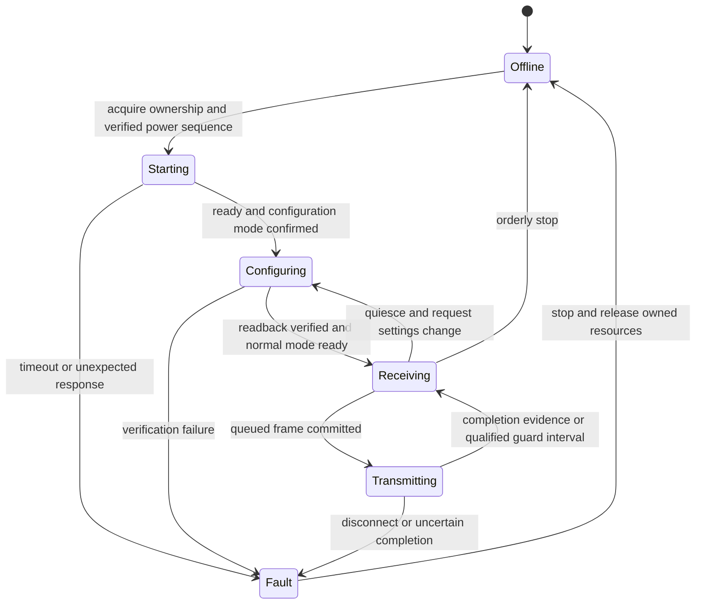

# E220/E22 radio abstraction and T865 board driver plan

Date: 2026-11-13. Companion to the [Rust routing plan](MESHTASTIC-RUST-PLAN.md).
This is a proposed implementation and test plan, not a claim of tested RF access.

## 1. Hardware boundary and present evidence

Use power, mode control and `/dev/ttysWK2` for module operation. Defer voltage
and timing decisions until the FPC live-probing adapter is ready. Preserve AUX
as an optional capability; no measured direct connection to it exists on P3,
P8 or P10. Do not treat those resistance readings as a GPIO assignment.

| Connection | Established on the current carrier | Still needed |
| --- | --- | --- |
| Ground | P1; P5 also has continuity to module ground | Confirm adapter continuity before live capture |
| Power | P2 feeds U1 and MP2155 VIN/EN; MP2155 output reaches E220 VCC | P2 on/off voltage, radio VCC, startup/Tx sag, shutdown timing and control ownership |
| UART to radio | P12 → radio RXD, about 22 Ω; tablet WK2 TX | Loaded high/low levels and edge quality |
| UART from radio | Radio TXD → P11, about 22 Ω; tablet WK2 RX | Loaded levels and input compatibility |
| M0 | Radio M0 → upper Q2 lone terminal; pull-up to U1/U2 VCC rail | Which P4/P6 branch controls Q2, terminal identities and polarity |
| M1 | Radio M1 → lower Q1 lone terminal; pull-up to same rail | Which P4/P6 branch controls Q1 and polarity |
| Candidate inputs | P4 → R30; P6 reported connected to R33; 1 kΩ/46 kΩ networks | Complete branch-to-Q mapping and usable tablet logical I/O numbers |
| EEPROM | P7 SDA and P9 SCL through about 22 Ω | Not needed for packet routing; leave recognition policy unchanged |

Sources: [measurements](../measurements.md),
[GpioControl trace](../gpio-control-api.md),
[DMD binary analysis](../reports/DMD-LoRa-analysis.md).

Keep connector P numbers, radio pad numbers, logical I/O indices and Linux GPIO
numbers as distinct types/names. Do not assume logical I/O 2/3 are mode controls
on T865 merely because the MDT781 SDK branch uses them that way.

## 2. Can the E22 replace the E220 physically?

**The published geometry supports the hypothesis, but does not yet qualify a
specific replacement module.** Compare signal names and physical coordinates,
not matching pin numbers.

The user-linked [Hubtronics E22 manual][e22-hub] supplies the 1–7 signal mapping
below. Its text was accessible, but its diagram could not be retrieved for
visual inspection. A separate [EBYTE-hosted E22 manual][e22-oem] was downloaded
and its dimension drawing visually compared with the
[user-confirmed E220 manual][e220-local]. They show matching 25 × 40.5 mm outlines,
2.54 mm side-pad pitch and corresponding control/RF pad locations. The E22 drawing
labels 18 physical pads using numbering that runs to 24 with gaps; “24” as the
highest label does not mean 24 physical pads in that drawing.

In the drawings' shield-side view, antenna connector near the lower left:

| Physical position | E220 pad / function | E22 pad / function |
| --- | --- | --- |
| Left, first from top | 7 GND | 1 GND |
| Left, second | 6 VCC | 2 VCC |
| Left, third | 5 AUX | 3 AUX |
| Left, fourth | 4 TXD | 4 TXD |
| Left, fifth | 3 RXD | 5 RXD |
| Left, sixth | 2 M1 | 6 M1 |
| Left, seventh | 1 M0 | 7 M0 |
| Bottom, left to right | 18 ANT, 17/16/15 GND | 11 ANT, 12/13/14 GND |
| Right, second from top | 9 GND | 23 GND |
| Right, first from top | 8 NC | 24: NC in linked copy; NRST in OEM copy |
| Right, fourth from top | 11 NC | 21: NC in linked copy; +3.3 V in OEM copy |

That revision disagreement matters. Verify the actual purchased module's
revision and pad functions, especially every E220 NC pad that the carrier may
connect to copper. Do not drive an E22 +3.3 V pad based on its label alone.
Check pads, solder-mask openings, underside clearance, antenna connection,
regulator headroom and Tx-current transients before rework. The E220 table's
textual “1.27 mm” connector entry conflicts with its 2.54 mm dimension drawing;
use the drawing and the actual board rather than that isolated table entry.

An E22-900T30S swap retains a UART module. Its SX1262 is a better candidate for
Meshtastic's slower presets, but does not automatically expose SPI or raw LoRa
commands to the tablet. E22 “M” SPI parts are a separate design option with their
own footprints and wiring, not an assumed substitute for this “T” module.

## 3. Backend capabilities, initially conservative

Both manuals describe a vendor packetizing UART interface. They do not document
host selection of all of Meshtastic's required raw PHY/framing settings. Treat
unknown/custom module firmware as a separate profile, identified by readback
and capture; the standard manual alone cannot establish what Thork's firmware
adds.

| Capability | Stock E220 UART | Stock E22 UART | Implementation consequence |
| --- | --- | --- | --- |
| Raw Meshtastic RF frame | Not established | Not established | Native mode disabled until bidirectional verification |
| Independent SF/BW/CR/sync/preamble | Not documented as a complete raw interface | Same issue despite SX1262 inside | Air-rate index alone is insufficient |
| Vendor packet limit in reviewed manuals | 200 bytes | 240 bytes | Both below reference Meshtastic's 255-byte RF ceiling |
| Host-visible CAD | Not established | Not established | Vendor LBT gets its own capability, not a fake CAD result |
| RX SNR | Not documented in reviewed UART interface | Not documented | Optional metadata; no fabricated zero |
| RSSI | Vendor-dependent output | Vendor-dependent output | Decode only for the identified firmware/profile |
| Exact RF TX-done | Not provided by UART drain | Not provided by UART drain | AUX high is not proof of RF completion either |
| Cancel after UART submission | Not established | Not established | Keep cancellable delay in host queue |

An EBYTE MTU mismatch is not a license to split a stock Meshtastic RF packet into
vendor fragments and call it interoperable. A private EBYTE network may define
its own framing/reassembly; a stock node cannot be assumed to understand it.

### Native interoperability experiment

Once controls and voltages are verified, use one stock Meshtastic reference
radio and record a complete PHY tuple: center frequency, bandwidth, spreading
factor, coding rate, sync word, preamble, explicit/implicit header, CRC and IQ
settings. Extract these from the pinned driver/backend, including its RadioLib
configuration. The pinned firmware uses logical sync word `0x2b`; do not confuse
that with the chip-specific register encoding.

The documented EBYTE channel grid is `850.125 MHz + channel × 1 MHz`. A typical
Meshtastic frequency need not land on it. First calculate whether the chosen
peer profile is representable at all; use a deliberately matched custom test
profile where possible. Do not round a Meshtastic frequency to the nearest
EBYTE channel and assume the bandwidth makes that acceptable.

Receive first. Send known exact frames in each direction in the controlled test
setup and compare byte-for-byte, including zero bytes, maximum sizes and unknown
payloads. Account for vendor address, encryption, CRC, metadata and packetization
rather than assuming “transparent” means raw over-air compatibility. A zero
vendor key does not prove that proprietary framing/transformation is absent.

Fail the native gate if no exact matching PHY/framing is available. Record a
specific reason such as `UnsupportedSyncWord`, `FrequencyNotRepresentable`,
`OpaqueAirFraming` or `FrameTooLarge`. A small successful packet alone does not
qualify larger frames or all presets. Publish only tested capability profiles.

## 4. Rust module organization and API

Inside `rust/radio`, separate ordinary modules, not a large plugin framework:

| Module | Responsibility |
| --- | --- |
| `contract` | Frames, optional metadata, capabilities, settings and errors |
| `ebyte` | Model-specific register codecs and mode-transition state |
| `uart` | Nonblocking transport, incremental parser, bounded buffering |
| `board` | Abstract power/mode/AUX access; T865 adapter lives at host boundary |
| `sim` | Scripted link events for driver and router tests |

Suggested interface shape, to refine during stage A:

- `capabilities()` returns support and evidence status, not just model branding.
- `configure(profile)` returns effective settings or a reason it cannot comply.
- `submit(frame, token)` accepts a bounded opaque frame or returns backpressure.
- `cancel(token)` distinguishes cancelled from already committed/unsupported.
- `handle_io(bytes_or_edge, now)` and `poll(now)` produce RX, TX-status and fault
  events; `next_deadline()` drives the host loop without fixed polling sleeps.
- `assess_channel()` returns CAD, vendor-only LBT, busy, or unknown explicitly.
- `shutdown()` releases ownership and reports incomplete transmissions.

`RxFrame` contains bytes, optional RSSI/SNR, receive timestamp and its source
(host arrival versus hardware). `TxStatus` distinguishes queued, UART accepted,
UART drained, estimated module completion and verified RF done. The router
starts deadlines with the appropriate uncertainty margin and never tells the
user “delivered” merely because `write()` succeeded.

A `BoardControl` boundary requests semantic states such as normal/configuration,
power on/off and readiness. A verified board profile translates those requests
into logical I/O, polarity and timing. It must not encode connector P4/P6 as
hardcoded kernel GPIOs. Provide direct-control and service-mediated variants
only as their actual capabilities are established.

## 5. Model-specific configuration

Do not share register offsets or mode truth tables blindly. Reviewed manuals:

| Setting | E220-900T30S | E22-900T30S |
| --- | --- | --- |
| Normal mode, M1/M0 | 0/0 | 0/0 |
| 0/1 | WOR transmitter | WOR, direction selected by configuration |
| 1/0 | WOR receiver | Configuration |
| 1/1 | Configuration/sleep | Deep sleep |
| UART/air-rate register | 0x02 | 0x03; 0x02 is NETID |
| Packet/power register | 0x03 | 0x04 |
| Channel register | 0x04 | 0x05 |
| Options register | 0x05 | 0x06 |

Sources: E220 sections 6–7 and E22 sections 6–7; retain profile-specific tests.
The E220 manual has inconsistent example prose/commands: its mode-1 paragraph
contradicts the summary table, and some channel examples use 0x05 despite the
register table assigning channel to 0x04. Treat the table as the initial hypothesis
and verify register readback; do not execute copied examples without reconciliation.

For the normal register protocol, parse the command, address, length and reply
incrementally. Keep E220, E22 and observed Topicon/DMD extensions as explicit
profiles. `C1` reads, `C2` temporary writes and `C0` persistent writes must be
separate operations; default configuration work to temporary settings where the
identified profile supports them. Never write a whole register block just to
change one field. Read-modify-write, preserve reserved bits, then verify readback.

DMD's captured `C0 C1 C2 C3 02 xx` mode commands and `AT+FWCODE`/other AT commands
are evidence of what its software sends, not proof that stock E22 supports them.
Do not auto-detect by sending these bytes in normal radio mode: unsupported
commands might be transmitted as payload. Start from an explicitly selected
model/profile and physically verified configuration mode. Unknown identity or
ambiguous replies stop configuration; no guessed baud/register sweep.

Configuration and packet traffic share a UART, so serialize them. Stop new TX,
finish or explicitly abort pending work, enter configuration, wait for readiness,
read/modify/verify, restore normal mode and only then resume the data parser.
Use documented mode timing as a minimum and measured firmware behavior to set
bounded deadlines. Do not clear input indiscriminately while application packets
or command replies may be arriving.

## 6. State machine and UART behavior

A no-AUX variant needs conservative measured guard intervals, bounded writes and
explicit uncertain-completion status. It cannot manufacture a readiness edge.
The recovery policy must avoid automatically retransmitting a partially accepted
frame until the router can decide how to handle a possible duplicate.

Open UART with `O_RDWR | O_NOCTTY | O_NONBLOCK | O_CLOEXEC`; report errno and
SELinux context. Apply raw termios with explicit baud/framing, disable software
flow control and unused hardware flow control, and handle partial reads/writes,
`EINTR`, `EAGAIN`, hangup and ownership loss. `tcdrain` only concerns the UART;
it cannot establish radio completion. UART initialization occurs only within an
explicitly started radio session.

Never interpret a Linux `read()` return as an RF packet boundary. Android
scheduling, FIFO buffering and driver reads can split or join module output.
The earlier DMD 22 ms idle aggregation is an observed application heuristic,
not a proven RF delimiter.

For the **private EBYTE experimental backend**, define a versioned bounded
length-and-integrity envelope, with a sync marker and escaping/resynchronization
rules (for example COBS plus length and CRC). Calculate encoded overhead against
the module's packet limit. Start with one envelope small enough for one vendor
packet; add bounded fragmentation only if an application requires it. Disable
optional vendor RSSI bytes until their placement is unambiguously parseable.
This envelope is deliberately not transmitted by a native Meshtastic backend.
For native RF, require a real packet boundary mechanism; idle-time guesses are
insufficient to qualify it.

Do not mistake the vendor repeater option for Meshtastic routing. Keep automatic
vendor repeating disabled during host-managed mesh tests, where supported, so
one host TX cannot create unaccounted extra relays. WOR and built-in encryption
also need explicit profile choices; they are not Meshtastic features by name.

## 7. T865 control and ownership validation

The existing trace shows DMD calls `setPower(position=2,true)`, then writes
logical I/O 1, waits and opens WK2. It does not establish that the first operation
is redundant, that I/O 1 is M0/M1, or that power ownership can be handed to another
app. Its release path may turn power off.

During the later controlled bench session:

1. Record actual module firmware/model and baseline state, then map physical
   P4/P6 to M0/M1 and identify polarity with the adapter. Do not sweep undocumented
   GPIO indices; use traced calls and a bounded test for known candidate paths.
2. Verify cold-start power and mode behavior, including what happens when the
   DMD process exits. Observe P2, regulator output and UART/mode levels together.
3. Test open and the required known ioctls under our normal app UID. Record raw
   return/errno; SDK `readIo` boolean semantics cannot distinguish every failure
   and are not direct voltage readback.
4. Verify one UART owner and one reader. Keep a live session exclusively in
   our app or in a service that provides the complete needed contract.
5. Confirm normal/configuration entry, read-only register reply and recovery
   before attempting any configuration write or RF transmission.

Keep the recovered `/dev/expand` ABI behind one adapter: the ioctl payload is
28 bytes, with observed offsets for I/O, type, state and position. Use zeroed
buffers, exact width assertions and errno reporting if implementing it directly.
A successful ioctl does not verify the electrical result. No root or SELinux
policy change is part of this plan.

## 8. Tests and decision points

Write scripted UART tests before hardware is ready: replies split at every
byte; multiple replies in one read; bad length; unknown model; stale response;
partial write; disconnect after a prefix; stuck-low/absent AUX; failed mode
transition; register readback mismatch; queue overflow; cancellation after commit.
Check that no fault path sends configuration bytes as application payload.

Then test two EBYTE peers with patterned binary messages containing every byte
value and sizes around the selected limit. Record both serial streams and
module/AUX timing where accessible. Test back-to-back packets, slow UART drain,
power reset and overrun recovery. Results qualify only the identified pair of
hardware/firmware profiles, not every E220/E22 revision.

For native Meshtastic, run the independent RF gate above before mixed-node
routing tests. If blocked, the most useful hardware alternative for retaining
Rust routing is a small MCU plus an accessible raw LoRa transceiver, with framed
UART commands for configure/RX/TX/CAD/status. A complete Meshtastic MCU node is a
different fallback that already owns routing. Do not assume the sealed E22 MCU
can be reflashed: programming access, firmware availability and recovery are
separate unanswered questions.

Until live probing is ready, implement parsers, simulated links and routing tests.
Do not select level shifting, final power limits or permanent register values
from the unloaded 2.5 V UART measurements. Configure region/frequency/power/airtime
limits explicitly before RF testing; the hardware's 1 W rating is not the
selected test power.

## References

- [Current measurement record](../measurements.md)
- [GpioControl ABI and call trace](../gpio-control-api.md)
- [Observed DMD UART protocol](../reports/DMD-LoRa-analysis.md)
- [Exact E220 manual][e220-local], sections 3, 5–7
- [User-linked E22 manual][e22-hub], sections 3, 5–7
- [EBYTE E22 manual][e22-oem], separate revision, drawing on PDF page 9
- [Archived OEM E22 copy](../../references/lora-teardown/E22-900T30S-manufacturer-2022.pdf)
- [Reference provenance and hash](../../references/lora-teardown/sources.md)
- [Meshtastic raw radio interface][mesh-radio]

[e220-local]: ../../references/lora-teardown/E220-900T30S_UserManual_EN_v1.0.pdf
[e22-hub]: https://hubtronics.in/docs/E22-900T30S-UserManual.pdf
[e22-oem]: https://www.cdebyte.com/Uploadfiles/Files/2022-1-19/2022119174379296.pdf
[mesh-radio]: https://github.com/meshtastic/firmware/blob/6d41e279f1f51bd59f687b9d441c1bf47b1594fc/src/mesh/RadioInterface.h
