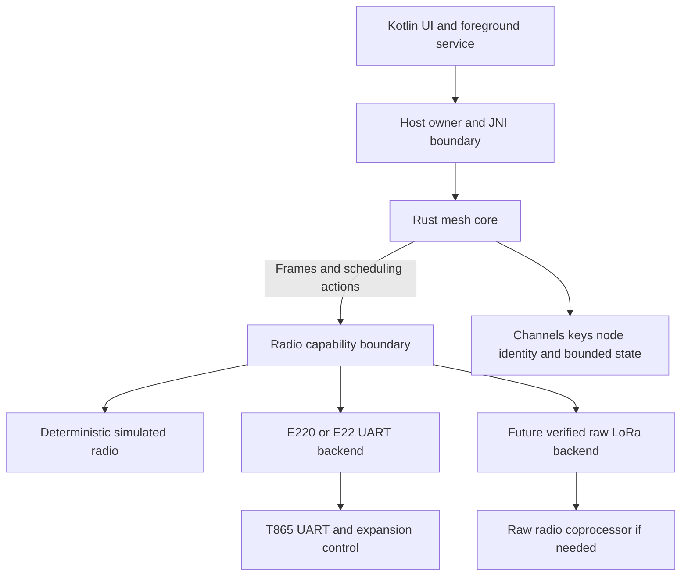

# Rust Meshtastic implementation plan

Date: 2026-11-13. Status: design and research; no Rust implementation or RF
interoperability test has been performed. Live electrical measurements await the
user's FPC adapter. This plan does not change the tablet or radio configuration.

## 1. Decision and scope

Build a deterministic Rust routing engine and a separate radio module. Start
with desktop simulation and captured packet fixtures while the adapter is being
soldered. Develop the EBYTE UART driver independently of routing.

**Do not equate a working E220/E22 UART link with Meshtastic RF compatibility.**
Power, M0/M1 and UART are enough to operate the vendor module interface, once
mapped and electrically verified. They do not necessarily expose raw LoRa
packets, modem parameters or channel activity detection. AUX would improve
readiness/flow control, but no connector path to it has been established.

There are three distinct deliverables:

| Product | Where routing runs | Compatibility claim |
| --- | --- | --- |
| Native Rust Meshtastic node | Tablet Rust engine; radio supplies raw LoRa frames | Stock Meshtastic interoperability, only after the RF and protocol gates pass |
| Experimental EBYTE mesh | Same Rust routing policies over an explicitly framed EBYTE link | Private network of compatible implementations; not a stock Meshtastic RF node |
| Client of a complete Meshtastic node | External node runs Meshtastic; tablet uses its client API | Practical fallback, but routing does not run in our Rust engine |

The requested work targets the first product, retaining the second as a useful
bench backend. The third is a contingency, not a substitute for implementing the
requested routing core. Neither E220 nor E22 should initially advertise native
Meshtastic capability. See the [separate driver plan](EBYTE-RADIO-DRIVER.md).

## 2. Pin the protocol before implementing it

Use these exact retrieved revisions as the initial reference profile:

| Reference | Pinned revision / interpretation |
| --- | --- |
| [Meshtastic firmware][firmware] | `6d41e279f1f51bd59f687b9d441c1bf47b1594fc`; its `version.properties` says 2.7.27 |
| [Firmware's protobuf submodule][protobufs] | `cf0a84ede1e7a0b7479e90a5e496d30c5dfba707`; resolved from that firmware's Git submodule entry |
| Live [routing documentation][routing-doc] | Retrieved 2026-11-13; currently labelled 2.8; useful overview, not a replacement for pinned behavior |
| Live [encryption documentation][encryption-doc] | Describes later 2.8.1 channel AEAD and DM acknowledgement proofs; outside the initial profile |

The retrieved documentation and code are not identical protocol snapshots. For
example, the pinned `NextHopRouter.h` defines originating transmission count 3
and intermediate count 2; the current overview describes a different DM count.
Use the pinned code and differential tests for the first implementation, not a
mixture of constants from both. Do not describe this profile as “latest.” Before
RF tests, record the actual peer build and either install the reference build or
explicitly add and test a second compatibility profile.

Create `rust/COMPATIBILITY.md` during implementation: firmware/protobuf SHAs,
fixture provenance, supported roles/ports/crypto, measured backend capabilities,
and known deviations. Do not silently follow a Git branch in builds.

The [official Rust library][rust-client] implements the client API of a device
already running Meshtastic. Its `PacketRouter` name does not make it an over-air
routing engine. Reuse its client API for the contingency path. For the routing
core, generate `prost` types from the pinned protobuf tree unless an existing
crate's generated schema is verified to match exactly.

## 3. What the E220 chip limitation actually means

Routing algorithms and LoRa modem presets are separate concerns. Managed flooding
and next-hop selection can execute on the tablet with either module. Missing
raw packet access can prevent all stock interoperability; missing SNR/CAD affects
faithful scheduling; the LLCC68's SF/bandwidth limits exclude particular presets.

These are **chip-level comparisons**, not supported settings of the UART driver.
Values come from pinned [MeshRadio.h][presets] and [Semtech LLCC68 limits][llcc68].

| Sub-GHz preset in reference | SF | BW kHz | LLCC68 PHY envelope | E22/SX1262 potential |
| --- | --- | --- | --- | --- |
| Short Turbo | 7 | 500 | Within envelope | Within envelope |
| Short Fast | 7 | 250 | Within envelope | Within envelope |
| Short Slow | 8 | 250 | Within envelope | Within envelope |
| Medium Fast | 9 | 250 | Within envelope | Within envelope |
| Medium Slow | 10 | 250 | Within envelope | Within envelope |
| Long Fast | 11 | 250 | Outside envelope | Within envelope |
| Long Moderate | 11 | 125 | Outside envelope | Within envelope |
| Long Slow | 12 | 125 | Outside envelope | Within envelope |
| Long Turbo | 11 | 500 | Within envelope | Within envelope |

“In envelope” does not establish matching coding rate, sync word, frequency,
framing or firmware support. Bandwidth availability also depends on the selected
region. Reject unsupported presets explicitly; never substitute a faster mode
while displaying the requested one. E22 can remove the LLCC68 PHY restriction,
but its stock UART firmware remains a separate obstacle.

## 4. Workspace and boundaries

Keep everything in this repository. Add a Rust workspace when implementation
starts, not empty crates in this documentation change.

| Proposed location | Responsibility |
| --- | --- |
| `rust/mesh-core/` | Wire codec, channels/crypto, packet history, flooding, reliability, next-hop state and scheduling decisions |
| `rust/radio/` | Capability contract, E220/E22 protocols, UART framing, mode transitions; simulator backend and later raw-radio backend |
| `rust/host/` | Desktop test runner first; Android JNI adapter and hardware ownership later |
| `rust/tests/fixtures/` | Small synthetic/public test vectors, firmware SHAs and expected events; no private channel keys |

Initially use standard Rust collections with explicit size limits and `std`.
Do not impose `no_std`, an actor framework or one crate per algorithm. Keep the
core independent of Android, UART, wall-clock time and any async runtime. Use
`prost` for the pinned messages and maintained crypto implementations; do not
write AES, CCM or X25519 primitives. Select and lock dependency versions when
building, with known-answer tests for the exact wire conventions.

The radio module accepts opaque bytes and returns link events. It does not
understand Meshtastic node IDs, ACK policy, routes, protobuf port numbers or
channel keys. The core never emits AT commands or `/dev/expand` ioctls.

Use a single event loop with an injected monotonic clock and seeded test RNG:
`handle(event, now, rng) -> actions`, plus `next_deadline()`. A small queue and
linear scans are adequate initially. Make ordering deterministic when RX and a
relay deadline coincide: process received packets before committing queued TX.

## 5. Packet codec and cryptography

Implement the over-air codec separately from `ToRadio`/`FromRadio`. The serial
client API's protobuf `MeshPacket` is not the radio packet layout.

For the pinned profile, [RadioInterface.h][wire] defines a 16-byte header:

| Offset | Size | Field |
| --- | --- | --- |
| 0 | 4 | Destination node ID, little endian |
| 4 | 4 | Original source node ID, little endian |
| 8 | 4 | Packet ID, little endian |
| 12 | 1 | Hop limit bits 0–2, want-ACK bit 3, via-MQTT bit 4, hop-start bits 5–7 |
| 13 | 1 | Channel hash |
| 14 | 1 | Next-hop hint |
| 15 | 1 | Relay-node hint |
| 16 onward | Variable | Encoded/encrypted `Data` payload |

Write byte slices explicitly; do not cast a Rust struct to bytes. The full RF
packet ceiling is 255 bytes in this profile, leaving at most 239 bytes after the
header, before crypto overhead. Enforce the protobuf schema's additional payload
limits too. Preserve received ciphertext when forwarding; only change permitted
routing fields. Unknown application ports must not require decoding to relay.

Implement and test these operations in order:

1. Header encode/decode, length checks, hop range, broadcast ID `0xffffffff`,
   next-hop “no preference” and legacy `hop_start == 0` interpretation.
2. `Data` protobuf codec and channel index versus over-air channel hash. Match
   [Channels.cpp][channels], including default-key expansion and hash collisions.
3. Channel AES-CTR compatibility. Match [CryptoEngine.cpp][crypto] nonce packing,
   key lengths and counter increment behavior with byte-for-byte fixtures.
4. PKI direct messages: X25519, SHA-256 of the shared secret and AES-256-CCM,
   with the reference nonce layout, 8-byte authentication tag and 4-byte extra
   nonce. Reject truncated messages, invalid keys and failed authentication.
5. NodeInfo/public-key exchange and key-change reporting. Do not silently send
   a private DM as a channel message when a recipient key is unavailable.

Persist node identity and packet-ID allocation safely. Reserve monotonic ID
ranges before use so a process crash cannot repeat a channel-CTR nonce; handle
exhaustion/identity changes explicitly. Retransmission reuses the original packet
and ciphertext; a newly created payload gets a new ID. An injected deterministic
RNG is for tests only; production keys and random nonces use OS entropy.

Relay logic can operate without decryption, but endpoint ACKs and application
processing must follow the selected security profile. Channel AES-CTR does not
authenticate its payload or header. Do not label a legacy routing ACK as a
cryptographic delivery proof. Later channel AEAD, signatures and ACK-proof support
need their own source pin and fixtures; do not invent extensions to the old wire
format. Keep keys and plaintext out of normal diagnostic logs.

## 6. Routing engine, implemented in layers

### 6.1 Shared state and admission

Maintain bounded tables for seen packets, pending relays, pending reliable sends,
node/public-key information and next-hop hints. Key packet state by original
`(from, id)`, not the short relay hint or packet ID alone. Carry link/profile
identity so fixtures, EBYTE experiments and native RF traffic cannot accidentally
share a history namespace. Preserve reference channel/transport checks within a
single mesh profile.

Validate RX length and origin before allocating state. Record transport,
receive time, optional SNR/RSSI and original raw bytes. Unknown SNR is `None`,
not 0 dB. Reject malformed data with a reason counter. Match the pinned
[PacketHistory.cpp][history] replacement/update semantics first; configurable
memory bounds must not accidentally create a short deduplication timeout.

A duplicate is not always an unconditional drop: greater remaining hop limit,
fallback from next-hop to flooding, repeated originating sends and lost-ACK
recovery all need the reference treatment. Maintain enough history to know which
short relay IDs were heard, whether we relayed and at what hop limit.

### 6.2 Managed flooding

Use [FloodingRouter.cpp][flooding] and the common router's forwarding predicates.
Start with the `CLIENT` role. On a valid new broadcast, deliver locally once;
if eligible and hops remain, schedule a delayed relay with the reference hop
update and this node's relay hint. The source ID and packet ID remain unchanged.

Before the deadline, receiving an eligible duplicate can cancel the queued
relay. A copy with a better remaining hop limit can replace a worse queued copy.
Do not rebroadcast self-originated packets as new packets. Handle zero-hop
packets locally without forwarding. Port role exceptions explicitly after the
basic tests: `CLIENT_MUTE`, `ROUTER`, `ROUTER_LATE`, and `CLIENT_BASE` favorites.
Do not collapse their cancellation or hop policies into a single boolean.

### 6.3 Reliability and ACK/NAK behavior

Implement [ReliableRouter.cpp][reliable] as pending-send state around the routing
engine. Distinguish local queue acceptance, actual/estimated RF transmission,
implicit acknowledgement by overhearing, explicit destination ACK, response and
NAK. Expose those distinct states to the UI.

A broadcast must not cause every receiver to send a positive ACK. Overheard
relaying can stop its retries. For unicast, apply the reference request/reply
correlation, destination checks and explicit ACK rules; suppress duplicate
application delivery while allowing a duplicate to trigger replacement of a lost
ACK. Avoid ACK loops, and handle the reference's reliable text-ACK exception.

Copy retry limits and airtime-sensitive timeout calculation from the pinned
profile into named policy constants with source links. Test retries at origins
and intermediate nodes separately. Busy/receiving intervals and queue delay must
not cause premature retries. Report final failure separately from “accepted by
radio.” An implicit ACK is not proof that the final destination received a DM.

### 6.4 Next-hop routing

Implement [NextHopRouter.cpp][next-hop] after reliable flooding passes.
Initially discover paths using flooding. Learn a destination's next-hop hint only
from the reference relationship between a successful reply/ACK and observed
forward relayers; do not simply choose the last/strongest packet's sender.

The wire hints are one byte, not full node IDs. Keep full node IDs in the node
DB, test short-ID collisions and preserve the protocol's no-preference sentinel.
Forward directed traffic when selected as next hop, apply intermediate retry
state, and clear a failed route for the reference final fallback to flooding.
Check that fallback is not discarded by the ordinary duplicate filter.

Use the pinned behavior for role-specific forwarding, hop updates and route
learning. Add explicit tests for stale routes, changed neighbors, repeated
packets, better-hop duplicates and destination ACK loss before enabling the
next-hop policy on real RF.

### 6.5 Channel access and queue control

Port the contention/timing behavior from [RadioInterface.cpp][timing] and
[RadioLibInterface.cpp][radiolib]. Model initial-send versus relay delay,
SNR-weighted contention, channel utilization, airtime and retry deadlines. The
core owns queue priority and cancellation until TX is committed; the backend
reports CAD busy/free/unknown and whether transmission can still be cancelled.

UART LBT is not a substitute for a host-visible CAD result. Lack of SNR can use
an explicitly experimental randomized fallback, but cannot be called exact
Meshtastic scheduling. Never fabricate link metadata to satisfy the algorithm.
Once bytes enter an opaque UART radio's buffer, cancellation may be impossible;
retain packets in the host queue until the chosen send time.

## 7. Radio contract and compatibility gate

Specify three states for each capability: documented, empirically verified, or
unavailable/unknown. Only an empirically validated profile unlocks native RF TX.

| Contract item | Required semantics |
| --- | --- |
| Configure | Exact effective modem settings or an explicit unsupported error; no silent rounding |
| Receive | Complete bounded frame, optional SNR/RSSI, timestamp and framing provenance |
| Send | Unique TX token, accepted/rejected result and eventual completion/failure status |
| Completion | Distinguish measured RF done from UART drained or estimated buffer completion |
| Channel assessment | CAD result, vendor LBT-only, or unavailable |
| Cancellation | Cancel queued TX or return already committed; no false success |
| MTU | Maximum opaque frame for this backend/profile, with framing overhead accounted for |
| Recovery | Fault/offline event, no automatic retransmission of stale configuration as payload |

See the [driver plan](EBYTE-RADIO-DRIVER.md) for concrete UART and board-control
state machines. A future MCU that exposes raw radio control over UART can satisfy
this interface without moving routing off the tablet. It needs explicit packet
lengths, PHY configuration, RX metadata, CAD, TX completion and flow control;
its local UART framing must be removed before RF transmission.

## 8. Android integration

Reuse the established `/dev/ttysWK2` open/termios work in
[the UART app](../../android/T865UartTx/) and the
[GpioControl investigation](../gpio-control-api.md). Do not introduce SPI access
as a requirement on the production tablet.

The host is the sole UART/control owner. Run the routing worker under an explicit
Kotlin foreground service; JNI exposes start/stop/configure/send and event
batches. Keep blocking reads, crypto and timers off the UI thread. Use a wake
lock only while actively operating, release it on stop, and test background,
screen-off and process-restart behavior. Pin NDK/Rust versions when implementation
starts and build the tablet's ABI plus a desktop test target.

Direct `/dev/expand` control remains an app-UID/SELinux and mapping test, not an
assumption from mode 0666. If the verified direct path fails, a DMD integration
must offer an explicit ownership/lease contract: who holds UART, who powers down
on disconnect, and whether mode control is available. Enabling DMD then racing it
for the same UART is not a supported design. The exported payload API does not
by itself expose a raw LoRa radio or all required timing controls.

Keep the two existing probe apps usable. Implement the new host separately
until the backend passes the bench gates, then decide whether to combine UIs.

## 9. Delivery order and acceptance tests

| Stage | Work / deliverable | Exit condition |
| --- | --- | --- |
| A: offline baseline | Pin sources, generate schema, wire codec, synthetic vectors and virtual clock | Exact header/protobuf vectors; malformed lengths and unknown fields handled |
| B: crypto and basic endpoint | Channel crypto, PKI fixtures, text/NodeInfo/routing port dispatch | Known-answer vectors match the pinned implementation; invalid tags/keys rejected |
| C: managed flooding | History, queue, cancellation and role baseline | Line, diamond and cycle simulations deliver once with bounded relays and correct hop exhaustion |
| D: reliable and next-hop | ACK/NAK, retries, route learning/fallback, role exceptions | Loss/reorder/duplicate/collision tests agree with reference traces |
| E: EBYTE backend | Scripted UART tests now; physical controls and register readback when adapter is ready | Driver round trips arbitrary binary payloads with a second identified EBYTE peer; ownership and recovery proven |
| F: native RF feasibility | Compare actual PHY and framing against a known Meshtastic radio | Bidirectional exact packet exchange at one fully specified common profile; otherwise keep EBYTE experimental |
| G: mixed mesh | Rust node plus two stock peers on the pinned/tested profile | Broadcast and DM over multiple hops; real destination ACK; retry/fallback and duplicate behavior verified |
| H: Android operation | Foreground service, JNI, persistence and diagnostics | Screen-off/background, restart, power loss and graceful stop tested without UART contention |

A–D can proceed before soldering is complete. E's protocol parser tests can too.
F is the hardware go/no-go gate; do not make an E22 rework prerequisite for
writing and testing the core.

The test harness uses seeded loss/reordering, a virtual monotonic clock and
recorded actions; it must not sleep for simulated airtime. Compare against
small reference traces from the pinned C++ implementation, not merely against
expected values invented by the Rust code. Keep trace provenance in fixtures.

Minimum regression scenarios:

- Two origins with the same packet ID; truncated/oversized frames; ID zero;
  unknown port/channel; channel hash collision; legacy header interpretation.
- Broadcast diamond suppression, loop termination, zero hops and better-hop
  duplicate replacement; cancellation exactly at a deadline.
- Dropped data, dropped ACK, delayed ACK and repeated origin TX; implicit ACK
  versus destination confirmation; role-specific duplicate cancellation.
- Next-hop discovery, hint collision, failed relay, last-attempt flooding and
  stale-route clearing; multiple pending destinations.
- Crypto key changes, failed CCM authentication, packet-ID persistence across
  crash/restart, and identical ciphertext for the same retransmission.
- Partial UART read/write, coalesced frames, disconnect mid-command, unexpected
  restart, stale replies, queue saturation and unknown AUX state.
- Native backend rejects unsupported PHY/MTU; experimental EBYTE encapsulation
  cannot be mistaken for native Meshtastic RF traffic.

Planned build checks: `cargo fmt --check`, `cargo clippy --workspace --all-targets`,
`cargo test --workspace`, host release build, Android target build and the existing
app build checks when integration changes them. These commands have **not** run
for this plan: there is no implementation to build yet.

## 10. Scope limits and next implementation slice

Start with text, NodeInfo and routing control. Add traceroute after forwarding and
ACK semantics stabilize. Position, telemetry and application ports can use the
same codec later. Remote administration, MQTT, BLE API emulation, signed
broadcasts and a full official-client-compatible server are separate work.

The next concrete slice is stages A and the simulated radio contract, followed
by B–D. In parallel, use the live adapter to finish the board profile listed in
the driver plan. If UART firmware cannot supply compatible raw RF frames, choose
between a private EBYTE mesh, an accessible raw-radio coprocessor, or an external
Meshtastic node; keep the Rust routing implementation reusable across that choice.

Preserve upstream attribution and license information when porting code. The
pinned [firmware license][license] and official Rust crate declare GPL-3.0;
record any reused/generated code and its license in the implementation.

## Source map

The links below identify the actual reference files reviewed, not just project
homepages. Live documentation may change; pinned code links are the baseline.

[firmware]: https://github.com/meshtastic/firmware/tree/6d41e279f1f51bd59f687b9d441c1bf47b1594fc
[protobufs]: https://github.com/meshtastic/protobufs/tree/cf0a84ede1e7a0b7479e90a5e496d30c5dfba707
[routing-doc]: https://meshtastic.org/docs/overview/mesh-algo/
[encryption-doc]: https://meshtastic.org/docs/overview/encryption/
[rust-client]: https://github.com/meshtastic/rust
[llcc68]: https://www.semtech.com/products/wireless-rf/lora-connect/llcc68
[presets]: https://github.com/meshtastic/firmware/blob/6d41e279f1f51bd59f687b9d441c1bf47b1594fc/src/mesh/MeshRadio.h
[wire]: https://github.com/meshtastic/firmware/blob/6d41e279f1f51bd59f687b9d441c1bf47b1594fc/src/mesh/RadioInterface.h
[crypto]: https://github.com/meshtastic/firmware/blob/6d41e279f1f51bd59f687b9d441c1bf47b1594fc/src/mesh/CryptoEngine.cpp
[channels]: https://github.com/meshtastic/firmware/blob/6d41e279f1f51bd59f687b9d441c1bf47b1594fc/src/mesh/Channels.cpp
[history]: https://github.com/meshtastic/firmware/blob/6d41e279f1f51bd59f687b9d441c1bf47b1594fc/src/mesh/PacketHistory.cpp
[flooding]: https://github.com/meshtastic/firmware/blob/6d41e279f1f51bd59f687b9d441c1bf47b1594fc/src/mesh/FloodingRouter.cpp
[reliable]: https://github.com/meshtastic/firmware/blob/6d41e279f1f51bd59f687b9d441c1bf47b1594fc/src/mesh/ReliableRouter.cpp
[next-hop]: https://github.com/meshtastic/firmware/blob/6d41e279f1f51bd59f687b9d441c1bf47b1594fc/src/mesh/NextHopRouter.cpp
[timing]: https://github.com/meshtastic/firmware/blob/6d41e279f1f51bd59f687b9d441c1bf47b1594fc/src/mesh/RadioInterface.cpp
[radiolib]: https://github.com/meshtastic/firmware/blob/6d41e279f1f51bd59f687b9d441c1bf47b1594fc/src/mesh/RadioLibInterface.cpp
[license]: https://github.com/meshtastic/firmware/blob/6d41e279f1f51bd59f687b9d441c1bf47b1594fc/LICENSE
