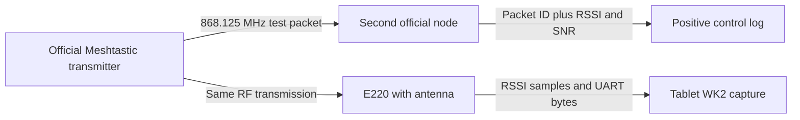

# E220 / Meshtastic feasibility test — 2026-11-16

## Decision

**Use a supported MCU/radio running official Meshtastic firmware for the module.**
The attached E220-900T30S, with firmware `7463-0-17`, did not deliver a single
Meshtastic packet in this bench test. UART, power control, firmware commands,
register access and RF-energy detection all worked. The installed UART firmware
does not expose the tested controls needed to match raw Meshtastic LoRa.

This is a practical decision for the supplied module and firmware, not a claim
that the underlying LLCC68 silicon can never communicate with Meshtastic. New
vendor firmware, an undocumented raw-radio interface, or bypassing the module's
controller could change the result. Those approaches have not been demonstrated
and offer little advantage over using an MCU with official firmware here.

## Actual hardware and starting state

| Item | Observed value |
| --- | --- |
| Tablet | T865, serial `865025220042`, production Android 16, no root |
| Carrier/module | Original Thork/Topicon carrier with E220-900T30S; antenna attached, confirmed by user |
| Module firmware reply | `FWCODE=7463-0-17` |
| UART | `/dev/ttysWK2`, 9600 baud, 8N1 |
| Power/enable | `/dev/expand`, position 2; traced power-on then logical I/O 1 high |
| Official transmitter | `!f9b31230`, TLORA_V2_1_1P6, firmware `2.7.26.54e0d8d` |
| Official control receiver | `!f9b24e98`, same hardware and firmware |
| DMD starting state | LoRa switch OFF, Open Mode ON; no active LoRa service |
| Original peer configs | EU868 LongFast, no frequency override, 27 dBm configured; preserved individually |

The native utility ran as shell UID 2000, SELinux `u:r:shell:s0`. A separate
check used the already-installed `dev.t865.mesh` app as UID 10205 in
`u:r:untrusted_app:s0:c205,c256,c512,c768`: its native power ioctls succeeded,
WK2 opened successfully, and normal Stop restored/closed UART and powered off.
Thus the immediate blocker is not a requirement for root or DMD's API.

No direct M0/M1 GPIO mapping was needed. The installed firmware accepted the
UART mode commands below. Physical mapping of the separate mode-control lines
remains outside this test.

## Control protocol actually verified

| Operation | Sent | Actual reply |
| --- | --- | --- |
| Software configuration mode | `C0 C1 C2 C3 02 03` | Same six-byte acknowledgement |
| Firmware query | `AT+FWCODE=?` + CR/LF | `FWCODE=7463-0-17` + CR/LF/NUL |
| Register block read | `C1 00 09` | `C1 00 09 00 00 62 24 12 10 00 00 10` |
| Software normal mode | `C0 C1 C2 C3 02 00` | Same six-byte acknowledgement |
| Software-switch query | `AT+SWITCH=?` | `AT+SWITCH=1` |
| Temporary rate change | `C2 02 01 xx`, with `xx=62..67` | Matching `C1 02 01 xx`; separate readback matched |
| Temporary zero vendor key | `C2 06 02 00 00` | `C1 06 02 00 00` acknowledgement |
| Ambient/last-RX RSSI read | `C0 C1 C2 C3 00 02` | `C1 00 02` followed by two RSSI bytes |

Saved settings decode to address 0, UART 9600/8N1, air-rate index 2 (2.4 kb/s),
200-byte vendor packet setting, channel 18, transparent transmission, LBT on,
no appended packet-RSSI byte, and ambient-RSSI querying enabled. Channel 18 is
**868.125 MHz** under the manufacturer's channel formula. Reserved bits were
preserved rather than assigned new meanings.

Recognized queries included ADDR, UART, RATE, CHANNEL, POWER, PACKET, TRANS,
LBT, DRSSI, URXT and UAUX. In contrast:

| Candidate control query | Reply |
| --- | --- |
| `AT+SF=?` | `FF FF FF` |
| `AT+BW=?` | `FF FF FF` |
| `AT+CR=?` | `FF FF FF` |
| `AT+SYNCWORD=?`, `AT+SYNC=?` | `FF FF FF` |
| `AT+FREQ=?` | `FF FF FF` |
| `AT+HELP` | `=ERR` |
| `AT+KEY=?` | `=ERR` |

These rejected commands establish that those candidate query forms do not work;
they do not prove that every possible undocumented command is absent. The
published register interface likewise provides vendor air-rate indices rather
than independent SF/BW/CR/sync controls.

The vendor key registers are write-only and read as zero according to the
manual. Neither a zero register read nor a failed KEY query establishes the
saved key. The second RF sweep therefore explicitly set a temporary zero key,
without rewriting the saved value.

## RF experiment

Both official nodes were temporarily set to **868.125 MHz**, CR 4/5, custom
SF/bandwidth settings and **13 dBm** configured TX power. Every configuration
was read back before a profile ran. Their primary channel settings were left
unchanged and the keys compared equal. `use_preset=false` was used throughout;
profile names in the table describe the equivalent SF/BW tuple. The otherwise
unused preset label stayed SHORT_FAST on both peers to keep their default
channel-name/hash behavior consistent.

For each profile, the E220 was tried at all six distinct documented air-rate
indices **2–7**, from 2.4 through 62.5 kb/s. Each temporary setting was acknowledged
and read back, then software normal mode acknowledged. The official transmitter
sent a unique PRIVATE_APP marker with zero requested hops and no requested ACK.
The E220 UART was monitored; any unsolicited bytes would have counted as a
candidate RF payload. No reads were treated as RF packet boundaries.

| Profile | SF | BW kHz | First sweep: control received | Zero-key sweep: control received | E220 payloads, both sweeps |
| --- | --- | --- | --- | --- | --- |
| ShortFast | 7 | 250 | 6/6 | 6/6 | 0/12 |
| ShortSlow | 8 | 250 | 5/6 | 6/6 | 0/12 |
| MediumFast | 9 | 250 | 6/6 | 5/6 | 0/12 |
| MediumSlow | 10 | 250 | 6/6 | 6/6 | 0/12 |
| Custom SF9/BW125 | 9 | 125 | 5/6 | 5/6 | 0/12 |
| Custom SF8/BW125 | 8 | 125 | 5/6 | 5/6 | 0/12 |
| Custom SF7/BW125 | 7 | 125 | 5/6 | 6/6 | 0/12 |
| **Full sweep totals** | | | **38/42** | **39/42** | **0/84** |

Seven submitted frames lacked a matching control reception within the capture
window; they are not counted as positively confirmed RF tests. The successful
control receptions independently demonstrate that real packets were going over
the air at each selected profile. The E220 produced zero payload bytes in both
sweeps, including the sweep with a known temporary zero vendor key.

### RF-energy confirmation

A final focused test used a settled control receiver, a warm-up frame, and a
200-byte payload at SF9/BW125, CR4/5, 868.125 MHz. The E220 was at its default
2.4 kb/s air-rate index and temporary zero key. During the long transmission,
its documented ambient-RSSI command was sampled. These five-byte diagnostic
replies were separated from candidate RF payload bytes.

| Focused long-packet observation | Result |
| --- | --- |
| Official packet ID | `3603817778` |
| Second official node decoded that exact packet | Yes; RSSI −46 dBm, SNR +10.25 dB |
| E220 channel RSSI before transmission | −74 dBm (`B6`) |
| E220 channel RSSI during transmission | Repeated −28 dBm (`E4`) |
| E220 last-packet RSSI field | Raw `00` throughout; no decoded-packet measurement reported |
| E220 UART RF payload | None |

Both focused frames reached the official receiver. Overall: **86 submissions,
79 matching official-node receptions, and zero E220 payload deliveries**.
The earlier sweep's long-frame probe also showed an RSSI rise, but lacked a
matched control reception within its shorter window; the focused result above
is the stronger evidence.

## Interpretation and limits

Power/enable and both UART directions work. The E220 responds in normal mode to
RSSI queries and detects substantial RF energy at the test frequency. The
failure is therefore consistent with incompatible demodulation/packet settings
or vendor framing/filtering, rather than a missing command channel or an absent
RF signal. We did **not** measure its actual over-air sync word or identify the
exact rejecting stage. A damaged packet-decoding path is not independently
excluded because a second compatible E220 was not available as a vendor-protocol
positive control.

The official firmware's radio driver fixes its LoRa sync word to `0x2b`.
No working exposed UART control for the E220's corresponding setting was found.
Matching a vendor air-rate number cannot establish matching SF, bandwidth,
coding rate, sync, header mode, CRC or proprietary framing. The E220's documented
200-byte vendor limit also falls short of Meshtastic's 255-byte RF ceiling.

This was not an exhaustive search of every coding rate or undocumented vendor
extension. CR4/6–4/8 were not swept. 500 kHz modes were not tested: this official
firmware falls back when bandwidth exceeds the selected EU868 region's 250 kHz
span. No E220 application-payload RF transmission was requested. These limits
prevent a universal impossibility claim, but do not provide a viable engineering
path for the supplied UART firmware.

## Recommended architecture

Use a supported **MCU + SX1262** board running official Meshtastic firmware,
with its UART configured for the **PROTO client API**. That supports normal
LongFast operation and keeps modem control, packet boundaries, crypto and
routing together in the maintained firmware. The tablet then uses its existing
client codec over WK2; the computer USB bridge is replaced by direct UART I/O.
Loaded logic levels, supply/current margin and the chosen board's free UART
pins still need to be checked before wiring it to the carrier.

A stock **E22-T UART module** would retain a vendor-controller boundary; its
SX1262 chip does not by itself prove raw Meshtastic access. It is not a qualified
fix for the interface problem found here. A raw SPI radio plus a supported MCU,
or a complete supported node, addresses that boundary explicitly. Further Rust
routing work for the stock E220 backend is not justified without new firmware
or raw-interface evidence.

## Restoration and evidence

Both official nodes were restored after **each** phase and their full LoRa
protobufs read back equal to their individual original snapshots. The E220
received only temporary register writes; power-off discarded them. Its final
power-cycle register response exactly matched the initial response. The saved
write-only key cannot be independently read back; no persistent key write was
made. DMD finished with LoRa OFF and Open Mode ON, matching the initial UI;
its preferences were not edited. The app capture service stopped, power was
requested off, both USB serial ports were released, and the tablet returned to
the mesh-bench Activity.

[Measurement bundle](../../measurements/e220-feasibility-2026-11-16/README.md),
[aggregate JSON](../../measurements/e220-feasibility-2026-11-16/summary.json),
[zero-key RF log](../../measurements/e220-feasibility-2026-11-16/rf2-experiment.jsonl),
[focused RSSI/control log](../../measurements/e220-feasibility-2026-11-16/rf3-experiment.jsonl),
[ordinary-app access log](../../measurements/e220-feasibility-2026-11-16/app-capture-logcat.txt).

Primary references:

- [Exact archived E220 manual](../../references/lora-teardown/E220-900T30S_UserManual_EN_v1.0.pdf), sections 6–7: normal/configuration modes, temporary C2 writes, register meanings, RSSI and write-only key.
- [EBYTE product specification](https://www.cdebyte.com/products/E220-900T30S/1): LLCC68 UART module, frequency grid, vendor air-rate range.
- [Actual peer-version radio driver](https://github.com/meshtastic/firmware/blob/54e0d8d/src/mesh/RadioLibInterface.h): fixed sync word and LoRa header/CRC behavior.
- [Actual peer-version configuration handling](https://github.com/meshtastic/firmware/blob/54e0d8d/src/mesh/RadioInterface.cpp): custom parameters, frequency override and region-width fallback.
- [Official serial PROTO documentation](https://meshtastic.org/docs/configuration/module/serial/): full client API over a configured UART. The live docs describe version 2.8; select the replacement board's actual firmware before configuring its pins.
