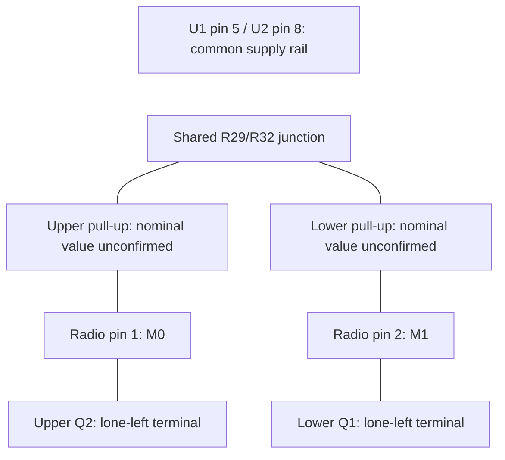

# Unpowered radio PCB probing plan - 2026-11-11

Goal: recover the carrier's connector net map while its connector-side
components are accessible. Later, use the FPC adapter for live connector
measurements. The original plan is dated 2026-11-11; user measurements from
2026-11-13 are recorded in the worksheet and interpretation sections below.

## Preparation and notation

Detach the radio PCB and FPC from the tablet and every power source. First
check DC voltage between the candidate supply and ground and allow stored
charge to decay before selecting resistance/continuity. Do not short rails
with a probe to discharge them. Use ordinary low-power resistance measurements;
avoid high-current low-ohms or insulation-test modes.

Label connector contacts P1..P12 by the tablet-back row-first convention:

| Left | Right |
| --- | --- |
| P1 | P2 |
| P3 | P4 |
| P5 | P6 |
| P7 | P8 |
| P9 | P10 |
| P11 | P12 |

Transfer this convention to a photo of the PCB by physical mating orientation,
not by counting left-to-right on the flipped board. Label both FPC ends too.
IC pin numbers below are a separate numbering system.

Measure shorted-lead resistance first. Record actual ohms, not just a beep.
A stable value close to the lead/contact baseline, in both probe directions,
supports a copper/zero-ohm connection. A higher stable value may be a resistor;
a rising value may be capacitor charging; polarity dependence suggests a
semiconductor path. A beep by itself is not proof of a direct net. Inductor
windings also measure almost zero ohms between electrically distinct switch
nodes. Prefer accessible resistor/capacitor pads connected to a chip pin over
balancing probes on adjacent fine-pitch IC pins.

## 1. Establish ground and check every contact against it

Start with P1 to U2 EEPROM pin 4 (GND), U1 LDO pin 2 (GND), and the radio's
GND pad identified from its package drawing. Check connector plane, antenna
connector outer/shield and RF shield can against the same reference rather
than assuming they all share DC ground.
Then measure P2..P12 to confirmed ground. Record stable low-resistance contacts
as candidate additional grounds; record changing readings separately.
Outcome: known meter reference and a ground-contact list. This can resolve
whether P8 is genuinely ground, unlike the earlier near-zero voltage alone.

## 2. Trace the power topology, starting with P2

Working hypothesis: P2 is the wide supply trace and may be switched upstream.
Check P2 to:

- U1 pin 1 VIN and pin 5 VOUT.
- Candidate MP2155 pin 5 VIN, pin 8 VCC, and pin 1 VOUT.
- Radio VCC pad.
- U2 EEPROM pin 8 VCC.

Repeat those checks for P7 and P9, which previously measured about 3.3 V.
Trace U1 VOUT and MP2155 VOUT to radio VCC and EEPROM VCC to determine which
regulator supplies which load. Follow series resistors, beads or diodes if
there is no direct continuity. Do not infer 3.3/5 V just from continuity.

Also record supply-to-ground resistance after several seconds, noting whether
it rises. In-circuit capacitance readings are not needed: the parallel circuitry
makes them ambiguous. This test cannot by itself prove that the tablet switches
P2, but it can establish whether P2 is a carrier supply input.

## 3. Find enable inputs and radio mode connections

Prioritize P3, since it previously pulsed during LoRa initialization. Check
P3 to U1 EN (pin 3), candidate MP2155 EN (pin 6), and radio M0/M1.
Then trace each of those four endpoints to all connector contacts, not only P3.
For each endpoint record whether it is:

- Directly connected to a contact.
- Connected through a resistor or transistor.
- Tied to a local supply or ground.
- Connected to another mode/enable endpoint.

Measure resistance to ground and to its associated supply to look for bias
resistors, but record in-circuit readings as approximate circuit resistance.
Specifically check M0-to-M1 continuity; they may be independent, joined, or
locally controlled. Do not confuse MP2155 MODE/SYNC with the radio's M0/M1.
Outcome: distinguish a power-enable signal from radio mode selection.

## 4. Trace UART and assign the paired KN devices

Existing bench result: P11 is tablet RX; P12 is tablet TX.
Expected endpoint pairing if this carrier uses that same UART:

- P11 -> radio TXD (radio output into tablet RX).
- P12 -> radio RXD (tablet output into radio RX).

The corrected radio-board measurements below confirm these endpoint pairings:
radio RXD pin 3 to P12 and TXD pin 4 to P11, approximately 22 Ω each. The user
corrected the initial pogo-contact count; the earlier discrepancy is resolved.

Check direct resistance first. If there is no direct connection, work inward
from each endpoint through nearby resistors and the two KN devices. On a photo,
label their three terminals A/B/C until the transistor pinout is verified;
the short marking is not enough to assume a BSS138 or ROHM pin order.
Map each terminal to connector contacts, radio UART endpoints, and local rails.
Record resistor markings and whether the paired circuits instead connect to
EEPROM SDA/SCL. This distinguishes UART translation from I2C translation.
Do not use in-circuit diode readings alone to identify the transistor.
Outcome: UART paths and any carrier-side voltage translation/bias network.

## 5. Map EEPROM and AUX

Trace U2 pin 5 SDA and pin 6 SCL to every connector contact, including through
series resistors or KN devices. Trace their pull-up resistor supply ends.
Check U2 pin 8 VCC against the already mapped rails.
Check address pins 1 A0, 2 A1, 3 A2 and pin 7 WP against GND and VCC.
The board's 0x56 label predicts A0 low, A1 high, A2 high if it is a 7-bit I2C
address; that remains a hypothesis until the straps or bus traffic confirm it.
Trace radio AUX to connector contacts and note any resistor/pull-up.
Outcome: identification bus, EEPROM supply/address/write-protect wiring and
radio busy/status output. No EEPROM programming or I2C scanning is needed now.

## 6. Verify the bare FPC and prepare the later live adapter

With BOTH ends disconnected, map each of its 12 contacts end-to-end and record
any contacts intentionally commoned together. Confirm the wide trace and plane
assignments. Check adjacent contacts for unintended solder bridges after any
adapter work. Do not assume straight-through numbering across mirrored faces.
Bring out all 12 contacts to labelled accessible pads/header terminals; provide
a verified ground connection beside signal access points. Preserve the original
supply/ground conductor capacity and mechanically support the flex and wires.
Keep signal branches short for later scope/logic-analyser use.

Before reassembly, take one labelled photo recording every confirmed endpoint.
If a necessary internal rail/EN is not exposed at the connector, either record
it as unavailable to the later connector-only test, or add an individually
insulated, strain-relieved test lead while unpowered if physically practical.
No internal powered probing is required for the present plan.

## Later powered observations (deferred, no commands executed)

- Measure P2 before/during/after a controlled LoRa enable cycle, including decay.
- Compare P3 and any mapped enable/mode/AUX signals with UART initialization.
- Capture EEPROM SDA/SCL to identify address and read traffic passively.
- Measure connector logic levels before attaching a logic analyser; regulator
  markings do not establish voltage at the tablet-facing signal contacts.

## Pinout references

IC pins below are separate from connector contacts P1–P12. Confirm package orientation before probing.

### U1: LP3987H-33B5F candidate

Verified manufacturer marking match; actual board output remains unmeasured.
See [LP3987H datasheet](../../references/lora-teardown/LP3987H.pdf), pages 1–2.

| IC pin | Signal |
| --- | --- |
| 1 | VIN |
| 2 | GND |
| 3 | EN |
| 4 | NC |
| 5 | VOUT |

### U1 orientation in the PCB close-up

In [IMG20261111200420](../../measurements/photos/lora-teardown-2026-11-11/previews/IMG20261111200420.jpg),
viewed from the component side with the `3R3` inductor below U1, the three-lead
side is on the left and the two-lead side is on the right. The small dot beside
the upper-left lead marks pin 1. This matches the manufacturer's top-view
package drawing on page 2 of the archived LP3987H datasheet.

| Position in that photograph | U1 pin | Signal |
| --- | --- | --- |
| Upper left, beside dot | 1 | VIN |
| Middle left | 2 | GND |
| Lower left, nearest inductor | 3 | EN |
| Lower right, nearest inductor | 4 | NC |
| Upper right | 5 | VOUT |

User reports P1 to U1 pin 2 (middle lead on the three-lead side) below 1 Ω
on 2026-11-13. Together with the two 0.8 Ω readings below, this supports a
common ground connection between P1, U1 GND, U2 GND and the U.FL shield.
Shorted-lead/contact resistance and reverse-probe readings remain unreported.

### U2: AT24C02C, eight-pin package

See the [Microchip datasheet](https://ww1.microchip.com/downloads/en/DeviceDoc/AT24C01C-AT24C02C-I2C-Compatible-Two-Wire-Serial-EEPROM-1Kbit-2Kbit-20006111A.pdf).

| IC pin | Signal |
| --- | --- |
| 1 | A0 |
| 2 | A1 |
| 3 | A2 |
| 4 | GND |
| 5 | SDA |
| 6 | SCL |
| 7 | WP |
| 8 | VCC |

### Candidate MP2155GQ

Confirm ground and inductor connections before relying on this identification.
See [MP2155 datasheet](../../references/lora-teardown/MP2155.pdf), pages 2 and 11.
L1 should connect between SW1/SW2. Its DC continuity does not make these
pins suitable supply-voltage measurement points.

| IC pin | Signal |
| --- | --- |
| 1 | VOUT |
| 2 | SW2 |
| 3 | PGND |
| 4 | SW1 |
| 5 | VIN |
| 6 | EN |
| 7 | MODE/SYNC |
| 8 | VCC |
| 9 | AGND |
| 10 | FB |

### EBYTE E220-900T30S — user-confirmed 18-pad package

Use the [exact module manual supplied by the user](../../references/lora-teardown/E220-900T30S_UserManual_EN_v1.0.pdf),
section 3, printed pages 6–7 (PDF pages 7–8). The package drawing and pin table
confirm **radio pin 6 = VCC**. The older archived E220-900T30S.pdf describes a
**different 24-pad layout** and is not the probing reference for this module.
Radio pin numbers remain distinct from connector contacts P1–P12.

| Radio pin | Signal |
| --- | --- |
| 1 | M0 |
| 2 | M1 |
| 3 | RXD |
| 4 | TXD |
| 5 | AUX |
| 6 | VCC |
| 7 | GND |
| 8 | NC |
| 9 | GND |
| 10–14 | NC |
| 15–17 | GND |
| 18 | ANT |

In the manual's shield-side drawing, with the antenna connector at the lower
left, pins 7 down to 1 run down the left edge; pins 8 through 14 run down the
right edge. The opposite-side drawing is mirrored. Use the matching view when
probing the mounted board.

## Minimal measurement worksheet (duplicate rows for multiple connections)

| Connector | Endpoint/component pad | Ohms | Reversed probes | Notes |
| --- | --- | --- | --- | --- |
| P1 | U2 pin 4 (GND) | 0.8 Ω | Not reported | User measurement, 2026-11-13; shorted-lead baseline not yet reported. |
| P1 | U.FL shield | 0.8 Ω | Not reported | User measurement, 2026-11-13; shorted-lead baseline not yet reported. |
| P1 | U1 pin 2 (GND) | <1 Ω | Not reported | User measurement, 2026-11-13; shorted-lead baseline not yet reported. |
| P2 | U2 pin 4 (GND) | ≈500 Ω | Not reported | User measurement, 2026-11-13. |
| P2 | U1 pin 1 (VIN) | <1 Ω | Not reported | User measurement, 2026-11-13. |
| P2 | Candidate MP2155 pin 5 (VIN) | <1 Ω | Not reported | User measurement, 2026-11-13; reported as MP2155p5 → P2. |
| P2 | Candidate MP2155 pin 6 (EN) | <1 Ω | Not reported | User measurement, 2026-11-13. |
| P2 | U1 pin 3 (EN) | <1 Ω | Not reported | User measurement, 2026-11-13. |
| P2 | U1 pin 5 (VOUT) | ≈570 Ω, red on U1 pin 5 | Open or ≈1.2 kΩ on re-probing; stable while held, black on U1 pin 5 | User measurement, 2026-11-13; see polarity-check table below. |
| P2 | U2 pin 8 (VCC) | Open | Not reported | User measurement, 2026-11-13. |
| P2 | Radio pin 6 (VCC) | Open | Not reported | User measurement, 2026-11-13. |
| P3 | U2 pin 4 (GND) | Open | Not reported | User measurement, 2026-11-13. From “others open”. |
| P3 | P1 (GND) | ≈1 kΩ, red P1 / black P3 | Open, red P3 / black P1 | Later polarity-specific user measurement, 2026-11-13. |
| P4 | U2 pin 4 (GND) | Open | Not reported | User measurement, 2026-11-13. From “others open”. |
| P4 | One end of R30 | <1 Ω | Not reported | User measurement, 2026-11-13; R30 itself measures ≈1 kΩ. |
| P5 | U2 pin 4 (GND) | <1 Ω | <1 Ω | User measurement, 2026-11-13; low resistance in both directions strongly supports a shared board ground. |
| P6 | U2 pin 4 (GND) | Open | Not reported | User measurement, 2026-11-13. From “others open”. |
| P6 | R33 (end unspecified) | Not supplied | Not reported | User reports connection, 2026-11-13; R33 itself measures ≈1 kΩ. |
| P7 | U2 pin 4 (GND) | ≈640 Ω | Not reported | User measurement, 2026-11-13. |
| P7 | U2 pin 5 (SDA) | ≈22 Ω | Not reported | User measurement, 2026-11-13; EEPROM I²C path identified. |
| P8 | U2 pin 4 (GND) | Open | Not reported | User measurement, 2026-11-13. |
| P9 | U2 pin 4 (GND) | ≈722 Ω | Not reported | User measurement, 2026-11-13. |
| P9 | U2 pin 6 (SCL) | ≈22 Ω | Not reported | User measurement, 2026-11-13; EEPROM I²C path identified. |
| P10 | U2 pin 4 (GND) | Open | Not reported | User measurement, 2026-11-13. From “others open”. |
| P11 | U2 pin 4 (GND) | ≈833 Ω | Not reported | User measurement, 2026-11-13. |
| P11 (tablet RX) | Radio pin 4 (TXD) | ≈22 Ω | Not reported | User-confirmed corrected pogo-contact count, 2026-11-13. |
| P12 | U2 pin 4 (GND) | ≈833 Ω | Not reported | User measurement, 2026-11-13. |
| P12 (tablet TX) | Radio pin 3 (RXD) | ≈22 Ω | Not reported | User-confirmed corrected pogo-contact count, 2026-11-13. |

Minimum useful completion: confirmed ground, P2's destination, P3's destination,
UART endpoints, radio M0/M1/AUX routing, EEPROM SDA/SCL/VCC, and FPC map.
Unresolved paths should remain marked unknown rather than guessed.

### Ground survey interpretation (2026-11-13)

The user confirms that U2 pin 4 was the accessible ground reference for this
connector survey; the pogo contacts are difficult to probe, so one connector
contact is measured at a time. “Others open” is interpreted as P3, P4, P6 and
P10. P1 already has the three ground-continuity measurements above. Meter range,
settling behaviour and shorted-lead baseline were not supplied. Reverse-probe
results are reported for P5 only. “Open” records the meter indication, not proof
that a contact has no circuit connection.

P5 to U2 pin 4 measures below 1 Ω in both probe directions, strongly supporting
P5 sharing the radio PCB ground. This establishes board-side continuity, not
the tablet-side contact's circuitry. The user suggests that the earlier unloaded
tablet-side P5 reading of 1.5 V could come from a weak pull-up. That is plausible
but unverified: no loaded tablet-side measurement or pull-up circuit trace exists.
Preserve the established mating-face numbering; the voltage difference alone
neither disproves the measured board ground nor proves a numbering error.

The finite 500–833 Ω readings are in-circuit resistance observations. They do
not identify discrete resistor values, supply voltage, input/output direction
or powered current consumption. Equal P11/P12 readings do not establish that
the two UART contacts are shorted together. The subsequent P2 trace below
establishes a low-resistance connection to U1 VIN. The later enable-wiring check is recorded below.

### P2 power-path trace (2026-11-13)

P2 to U1 pin 1 (VIN) measures below 1 Ω, establishing a low-resistance path
from the connector to the LDO input. P2 to U1 pin 5 (VOUT) reads approximately
570 Ω; P2 to U2 pin 8 (VCC) and to the radio pin 6 (VCC) read
open. Reverse-probe results and settling behaviour were not reported.
These readings do not establish the applied supply voltage, whether the tablet
switches P2, or which loads receive power through a regulator when enabled.
The 570 Ω value is an in-circuit measurement, not an identified discrete resistor.

**Radio pin-number resolution:** on 2026-11-13 the user supplied the exact
18-pad module manual. Its pin table confirms the measured radio VCC pad is pin 6.
The previous discrepancy came from the archived manual for a different 24-pad
layout; the reference table above now uses the correct 18-pad manual.

### U1 output trace (2026-11-13)

| From | To | Reported resistance |
| --- | --- | --- |
| U1 pin 5 (VOUT) | U2 pin 8 (VCC) | <1 Ω |
| U1 pin 5 (VOUT) | Radio pin 6 (VCC) | ≈650 Ω |
| Candidate MP2155 pin 1 (VOUT) | Radio pin 6 (VCC) | <1 Ω |

The low-resistance connection establishes that U2 EEPROM VCC shares U1's output
net. U1's marking identifies the nominal 3.3 V LDO variant; no powered output
voltage has been measured. The 650 Ω in-circuit reading does not establish a
shared rail with radio VCC or a discrete 650 Ω resistor. Radio supply routing was subsequently traced to candidate MP2155 VOUT (below). Reverse-probe readings and settling behaviour were not reported.

### U1 input/output probe-polarity check (2026-11-13)

| Red probe | Black probe | Reported resistance |
| --- | --- | --- |
| U1 pin 5 (VOUT) | P2 (connected to U1 VIN) | ≈570 Ω |
| P2 (connected to U1 VIN) | U1 pin 5 (VOUT) | Open or ≈1.2 kΩ on separate probe placements; stable while held |

The user now reports polarity-dependent readings between the LDO input and
output nets. This is consistent with semiconductor paths in the unpowered
circuit; it does not identify a fixed 570 Ω resistor or a particular internal
diode. The user clarifies that the reverse result changes only on re-probing:
each placement reads either open or approximately 1.2 kΩ, and the reading holds
while the probes remain in place. This is not a fluctuating reading under held
contact. The reason for the difference between placements has not been isolated;
the observation does not establish charging or meter-range changes.

Polarity dependence provides a plausible explanation for the earlier 570 Ω
P2-to-U1 pin 5 reading versus the open P2-to-U2 pin 8 reading, despite the
below-1 Ω connection between U1 pin 5 and U2 pin 8. The earlier probe polarity
was not recorded, and a matched-polarity repeat using U2 pin 8 has not been
reported, so retain both original observations. The direct low-resistance
connections still establish P2-to-U1 VIN and U1 VOUT-to-EEPROM VCC.

Subsequent regulator-enable results are recorded below.

### Shared regulator input (2026-11-13)

User reports candidate MP2155 pin 5 (VIN) to P2 below 1 Ω. Together with the
U1 pin 1 result, this places both regulator inputs on the P2 net, assuming the
candidate MP2155 identification/pin numbering. The two stages therefore share
an input. The output trace below identifies their respective loads. This does not establish
P2's operating voltage, upstream switching, or the converter's output voltage.

User subsequently reports candidate MP2155 pin 1 (VOUT) to radio pin 6 (VCC)
**<1 Ω**. This establishes the converter-output-to-radio-supply connection,
complementing the U1-output-to-EEPROM-supply result. Reverse-probe results were
not supplied. See the [supply-path diagram](../measurements.md#shared-regulator-input-and-traced-outputs).

The later EN trace places both enable inputs on P2 (below). Actual rail
voltages remain unmeasured.

### Enable wiring and P3 polarity check (2026-11-13)

| Connection / probe polarity | Reported result |
| --- | --- |
| Candidate MP2155 pin 6 (EN) to P2 | <1 Ω |
| P2 to U1 pin 3 (EN) | <1 Ω |
| P3 to regulator EN pins and radio M0/M1 | No direct connection reported; individual resistance values not supplied |
| Red on P1, black on P3 | ≈1 kΩ |
| Red on P3, black on P1 | Open |
| Diode mode: red P1, black P3 (assumed from “P#”) | 0.97 V |
| Diode mode: red P3 (same assumption), black P1 | Open / OL |

Both regulator EN pins join P2 alongside their VIN pins. This supports the
interpretation that both stages enable when P2 is powered, rather than receiving
separate direct enable signals from P3. Powered sequencing, input voltage and
upstream switching of P2 remain unmeasured. No direct P3-to-EN or P3-to-M0/M1
connection was found; this does not exclude indirect control through other parts.

The P3 reading is polarity-dependent and supports a semiconductor-path hypothesis.
The user suggests a MOSFET body diode. That is possible, but a ground-to-signal
ESD clamp can give the same conduction polarity; the resistance reading alone
identifies neither a MOSFET nor a fixed 1 kΩ resistor. General references:
[Toshiba on MOSFET body diodes](https://toshiba.semicon-storage.com/eu/semiconductor/knowledge/faq/mosfet/i-heard-that-mosfets-have-a-diode-between-drain-and-sourcewhat-k.html)
and [TI on ground clamp diodes](https://www.ti.com/document-viewer/lit/html/SSZTCN0/GUID-540DB5B6-45A1-40EF-A3C7-A07EB772C47F).
These explain candidate mechanisms, not identification of parts on this board.

The subsequent diode-mode report is 0.97 V with red on P1 and black on the
contact written as “P#”, and open in reverse. “P#” is interpreted as P3 from
the immediately preceding test; that interpretation has not been separately
confirmed. The result supports a diode-like path but does not identify a
particular junction or establish a MOSFET body diode.

Next unpowered check: trace P3 to terminals of the paired KN devices and nearby
protection parts without assuming their pinouts. Record any low-resistance
connection and which physical terminal it reaches.

### Q1/Q2 adjacent-resistor traces (2026-11-13)

Orientation for these observations: **pogo pins are up**. The user calls the
two devices Q1 and Q2; “lower-right” is a physical terminal position in this
orientation, not an assigned semiconductor pin number.

| From | To | Reported resistance |
| --- | --- | --- |
| Q1 lower-right terminal | Near end of its adjacent resistor | <1 Ω |
| Other end of Q1-adjacent resistor | P1 (GND) | <1 Ω |
| Q2 lower-right terminal | Near end of its adjacent resistor | <1 Ω |
| Other end of Q2-adjacent resistor | P1 (GND) | <1 Ω |

Each lower-right terminal has a path through its adjacent resistor to ground.
The two below-1 Ω trace segments are not a below-1 Ω terminal-to-ground reading.
The user's follow-up gives the resistor measurements below, using the same
pogo-pins-up orientation. Both left-side resistors connect to their respective
device's lone left terminal; the far ends of those resistors remain untraced.
No numerical continuity reading was supplied for these left-side connections.

| Resistor position | Reported in-circuit resistance |
| --- | --- |
| Right side, upper | ≈46 kΩ; R31/R34 pair later measured in both directions |
| Right side, lower | ≈46 kΩ; R31/R34 pair later measured in both directions |
| Left side, lower | Clarified: ≈4 kΩ with red on shared middle; ≈7.4 kΩ reversed |
| Left side, upper | Clarified: ≈4 kΩ with red on shared middle; ≈7.4 kΩ reversed |

The right-side values are recorded as approximately 46 kΩ each from the plural
report. The later user identification assigns upper to Q2 and lower to Q1,
with pogo pins up.
Printed markings and isolated component values were not supplied; parallel
board circuitry can affect these in-circuit readings. Gate/source/drain
assignments, exact device models and any P3 connection remain unestablished.

Follow-up on the opposite ends of the left-side resistors (the ends away from
the lone transistor terminals):

| From | To | Resistance mode | Continuity mode |
| --- | --- | --- | --- |
| Upper left resistor, opposite end | P3 | ≈2.2 MΩ | Open |
| Lower left resistor, opposite end | P3 | ≈2.2 MΩ | Open |

Both entries follow the user's plural report; probe polarity was not supplied.
The finite high-resistance reading and the open continuity indication are
consistent and show no direct continuity at these points. Do not record this
as a discrete 2.2 MΩ resistor or infer that all indirect P3 paths are excluded.
The destinations of these resistor ends remain unknown.

Upper-right terminal checks, with pogo pins up (2026-11-13):

| Red probe | Black probe | Reported resistance |
| --- | --- | --- |
| Q1 upper-right terminal | P3 | ≈19 kΩ |
| Q2 upper-right terminal | P3 | ≈19 kΩ |
| P3 | Q1 upper-right terminal | Several MΩ, slowly decreasing |
| P3 | Q2 upper-right terminal | Several MΩ, slowly decreasing |

No settled reverse value or observation duration was supplied. These readings
do not establish direct continuity to P3 or a discrete 19 kΩ resistor. Polarity
and time dependence are consistent with indirect semiconductor/charge-dependent
paths, but the mechanism has not been isolated. Similar readings at both
terminals do not establish that the terminals share a net.

Next unpowered check: Q1 upper-right to Q2 upper-right directly. If below 1 Ω,
trace that shared node to known rails (U1 pin 5 / EEPROM VCC, radio pin 6 VCC,
and P2). Keep gate/source/drain unassigned until the terminal mapping is verified.

### Radio UART-to-connector resistance (2026-11-13)

| Radio endpoint | Connector contact | Reported resistance |
| --- | --- | --- |
| Radio pin 3 (RXD) | P12 (tablet TX) | ≈22 Ω |
| Radio pin 4 (TXD) | P11 (tablet RX) | ≈22 Ω |

The user corrected the initial pogo-contact count: radio pin 3 connects to P12,
not P11, and explicitly confirmed radio pin 4 connects to P11. The intermediate
P4 mention was withdrawn. The corrected readings match the earlier powered
ESP32 bench identification of tablet P11 RX and P12 TX; the reported RX/TX
pairing discrepancy is resolved.

The measured paths are consistent with series resistance. Individual components
and reverse-probe readings have not been supplied; these measurements alone do
not establish a particular discrete 22 Ω resistor, complete UART conditioning
circuit, or powered operation of the radio.

### P3 I²C hypothesis (2026-11-13)

The user proposes that P3 may be I²C-related. The carrier's identification
EEPROM provides a concrete tracing target, but P3 has not been assigned to
SDA, SCL or another EEPROM signal. Its diode-like ground path does not identify
a bus function; no I²C traffic has been decoded on P3.

The user subsequently reports no direct connection from P3 to either EEPROM
I²C pin: U2 pin 5 (SDA) or pin 6 (SCL). Numerical resistance, meter mode and
probe polarity were not supplied. P3 remains unassigned; no direct SDA/SCL
connection was found, while indirect circuitry remains untraced.

### EEPROM I²C connector mapping (2026-11-13)

| EEPROM endpoint | Connector contact | Reported resistance |
| --- | --- | --- |
| U2 pin 5 (SDA) | P7 | ≈22 Ω |
| U2 pin 6 (SCL) | P9 | ≈22 Ω |

These user measurements identify P7 as the EEPROM SDA path and P9 as SCL.
The earlier approximately 3.3 V readings on these contacts are compatible with
idle I²C levels; they must not be treated as identified supply outputs. Pull-up
locations/values and powered bus traffic remain unmeasured. The approximately
22 Ω paths are consistent with series resistance, but individual components
and reverse-probe results have not been reported. P3 remains unassigned.

### Radio AUX-to-P3 check (2026-11-13)

| Red probe | Black probe | Reported resistance |
| --- | --- | --- |
| Radio pin 5 (AUX) | P3 | ≈50 kΩ |
| P3 | Radio pin 5 (AUX) | MΩ range; exact value not supplied |

The polarity-dependent, high-resistance readings do not establish a direct
AUX-to-P3 connection or identify a discrete 50 kΩ resistor. Settling behaviour
was not reported. P3's function and AUX's connector routing remain unknown;
an indirect path has not been ruled out.

Next unpowered check: keep one probe on radio pin 5 (AUX) and check the
remaining unassigned contacts P4, P6, P8 and P10 individually for a low-resistance
path. Record actual resistance rather than inferring a connection from a beep.

### Radio M0-to-ground check (2026-11-13)

| Red probe | Black probe | Reported resistance |
| --- | --- | --- |
| P5 (board ground) | Radio pin 1 (M0) | ≈10 kΩ |
| Radio pin 1 (M0) | P5 (board ground) | ≈7.5 kΩ |

P5 previously measured below 1 Ω to U2 ground in both directions, so these
readings characterize an M0-to-ground path. They establish neither direct
continuity nor a discrete 10 kΩ/7.5 kΩ pull-down. The polarity dependence
requires treating them as in-circuit readings; settling behaviour was not supplied.
The resemblance to the earlier 7.4 kΩ lower-left resistor reading does not
establish that this is the same path.

Next unpowered check: M0 to the lone left terminal of each Q1/Q2, with pogo
pins up, looking for low-resistance continuity. This tests whether either
paired device connects to radio mode control without assigning transistor pins.

### Radio M1-to-ground check (2026-11-13)

| Red probe | Black probe | Reported resistance |
| --- | --- | --- |
| P5 (board ground) | Radio pin 2 (M1) | ≈3.8 kΩ |
| Radio pin 2 (M1) | P5 (board ground) | ≈7.5 kΩ |

The compact report “black on M1->P53.8k, reversed 7.5” is interpreted as
P5 / 3.8 kΩ, with the reversed value in kΩ as in the preceding M0 measurement.
These are in-circuit readings, not direct continuity or identified resistor
values. Settling behaviour was not supplied. Similarity to the earlier
approximately 4 kΩ upper-left resistor reading is a tracing lead, not proof
of a connection.

The subsequent M1-to-upper-device lone-left check is recorded below. Later
direct-continuity results identify M1 with the lower device and M0 with the
upper device, as recorded in the mode-pin mapping section.

### M1 to upper device lone-left terminal (2026-11-13)

Orientation remains pogo pins up. “Upper” names the physical device position;
it was subsequently identified by the user as Q2 (lower device: Q1).

| Red probe | Black probe | Reported resistance |
| --- | --- | --- |
| Radio pin 2 (M1) | Upper device, lone-left terminal | ≈19.3 kΩ |
| Upper device, lone-left terminal | Radio pin 2 (M1) | ≈19.5 kΩ |

The close readings in both polarities do not establish direct continuity or
a specific discrete resistor. No settling or measurement-tolerance information
was supplied. The earlier resemblance between M1-to-ground and upper-left
resistor readings has not yielded a direct M1-to-lone-left connection.

Next unpowered checks: M1 to the upper device's upper-right terminal, then
its lower-right terminal, retaining physical position labels.

### Upper-left resistor endpoints clarified (2026-11-13)

With pogo pins up, label the upper-left resistor ends **A** (directly connected
to the upper device's lone-left terminal) and **B** (the opposite end). These
are local tracing labels, not transistor pin numbers.

| Measurement | Reported result |
| --- | --- |
| Resistor end A to upper device lone-left terminal | Direct connection reported; numerical resistance not restated |
| M1 to end A | ≈19 kΩ in clarification; earlier terminal readings 19.3/19.5 kΩ by polarity |
| M1 to end B | ≈4 kΩ; probe polarity not supplied |
| Across resistor A–B | ≈4 kΩ; user confirms this is the resistor reading |

The clarification does not report a below-1 Ω M1 connection to either end.
Keep the three resistance measurements separate: they do not support a simple
M1-to-terminal series-resistor model by arithmetic. Readings were taken in
circuit, and common polarity, settling conditions and contact repeatability
across all three measurements have not been established. No additional resistor
value or gate/source/drain assignment is inferred.

The later R29/R32 junction trace below identifies the shared resistor ends
with U2 VCC, resolving the supply-side junction.

### Radio mode pins mapped to paired devices (2026-11-13)

Orientation: **pogo pins up**. The user explicitly identifies **upper = Q2**
and **lower = Q1**. Gate/source/drain identities remain unassigned.

| Radio endpoint | Device terminal | Reported resistance |
| --- | --- | --- |
| Radio pin 1 (M0) | Upper Q2, lone-left terminal | <1 Ω; red M0, black Q2 terminal |
| Radio pin 2 (M1) | Lower Q1, lone-left terminal | <1 Ω; red M1, black Q1 terminal |

These direct-continuity measurements connect the paired KN devices to the
radio's mode signals. They do not yet establish how the devices are driven,
which semiconductor terminals these are, or any P3-to-mode control path.
The latest user checks explicitly place red on the radio mode pin and black
on the named Q terminal, confirming both the continuity and Q1/Q2 assignments.
Reverse-polarity repeats were not reported for these below-1 Ω checks.

The user identifies the shared middle junction as the connection between
**R29 and R32** and corrects “U8” to **U2 pin 8** for the following measurement.

| From | To | Reported resistance |
| --- | --- | --- |
| Shared R29/R32 middle junction | P1 (ground) | ≈330 Ω |
| U2 pin 8 (EEPROM VCC) | Shared R29/R32 middle junction | <1 Ω |

The 330 Ω value supersedes the initial 300 Ω report. The below-1 Ω connection
places the shared junction on **U1 VOUT / EEPROM VCC**. Thus 330 Ω is an
in-circuit rail-to-ground reading, not a discrete grounding resistor. Probe
polarity and settling behaviour were not supplied.

Together with the outer-end connections to the lone-left terminals and the
M0/M1 continuity results, this identifies **R29/R32 as mode-pin pull-ups** to
the LDO output rail. The user explicitly confirms that interpretation. U1 is
the nominal 3.3 V variant by marking; actual powered rail voltage remains
unmeasured. Which individual reference designator corresponds to upper versus
lower has not been separately recorded.

The user clarifies that **both R29/R32 have the same polarity-dependent
in-circuit readings**:

| Resistors tested | Red probe | Black probe | Reported resistance |
| --- | --- | --- | --- |
| Both R29 and R32 | Shared middle junction (U1 output / U2 VCC) | Respective outer, mode-pin end | ≈4 kΩ each |
| Both R29 and R32 | Respective outer, mode-pin end | Shared middle junction | ≈7.4 kΩ each |

This supersedes the earlier apparent upper/lower value difference: it was a
probe-polarity distinction in the reported readings, not evidence of different
resistor values. These remain in-circuit measurements affected by the surrounding
circuit; nominal resistor values and markings have not been established.

The known mode-node wiring is shown below; the transistor boxes identify only
measured terminal connections, not verified gate/source/drain assignments.

The paired devices may provide a way to pull the mode signals low, but their
remaining terminal functions and control inputs are still untraced. Next
unpowered checks: each device's upper-right terminal to U2 pin 4 (ground),
then trace the lower-right terminals toward connector contacts. No P3 control
assignment is established.

### Paired-device resistor junctions and P4/P6 paths (2026-11-13)

Orientation remains pogo pins up. The user supplies these component designators
and measurements:

| Component | Reported in-circuit resistance |
| --- | --- |
| R31 | ≈46 kΩ in both probe directions |
| R34 | ≈46 kΩ in both probe directions |
| R30 (rotated 90° relative to adjacent R31) | ≈1 kΩ in both probe directions |
| R33 (rotated 90° relative to adjacent R34) | ≈1 kΩ in both probe directions |

The lower end of each R31/R34 connects to its corresponding Q1/Q2 terminal and
to the corresponding 1 kΩ resistor. This extends the earlier lower-right-terminal
trace: the user now explicitly confirms the other ends of **R31 and R34**
each connect to **P1 at below 1 Ω**. Thus these are approximately 46 kΩ
pull-down branches on the respective Q/1 kΩ resistor junctions; the Q terminal
functions remain unassigned. Probe polarities for the ground-continuity checks
were not supplied. The final
parenthetical “1k resistor (R31/34)” is interpreted as R30/R33, consistent with
the component values explicitly given in the same report. Pair association
R31/R30 and R34/R33 follows the user's corresponding-pair description.

| Connection | Reported result |
| --- | --- |
| P4 to one end of R30 | <1 Ω |
| P6 to R33 | Connection reported; exact resistance and end not specified |
| R31 end opposite the Q/R30 junction | P1 ground: <1 Ω |
| R34 end opposite the Q/R33 junction | P1 ground: <1 Ω |

These identify P4 and P6 as candidate control inputs through the 1 kΩ
resistors to the paired mode-connected devices. The endpoints selected for the
connector checks were not explicitly identified relative to the transistor-side
junctions, so the complete series paths still need endpoint confirmation.
Do not record R33-to-P6 as below 1 Ω without a numerical reading.

Next unpowered checks: P4 to its corresponding Q lower-right terminal and P6
to its corresponding Q lower-right terminal. Approximately 1 kΩ would support
placement of R30/R33 in series. Record whether each is the upper (M0-connected)
or lower (M1-connected) device, then check the upper-right terminals to ground.
The transistor terminal identities, P4/P6-to-M0/M1 assignment and switching
polarity remain unverified; P3 remains unassigned.
